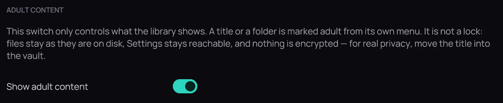

## What it is for

Hide titles tagged adult from every library screen — the rows, the grid, search and
*Recently played* — without touching the files themselves.

## How to use it

1. Open **Settings › Library › Folders** and find **Adult content**.
2. Click **Add adult folder…** and pick a folder; everything under it is tagged adult automatically.
3. Or tick **Adult content** on a category in **Settings › Library › Categories**: everything in it,
   folders and server libraries alike, is tagged adult.
4. Turn off **Show adult content** and click **Save**.
5. Turn on **Show adult content** again to bring them back exactly as you left them.

## Good to know

- It is a visibility switch, not a lock — Settings itself stays fully reachable, so it will not keep
  anyone out of it.
- To tag one title without a whole folder, right-click its card and choose **Mark as Adult**; for a
  folder of your own videos and photos, **Mark folder as adult**.
- Nothing is encrypted and nothing on disk moves — to encrypt, use the [vault](../private/index.md).
- For adult videos that are neither films nor series, make a category with **Personal** and
  **Adult content** ticked: nothing is looked up online, and the videos are grouped by folder.
