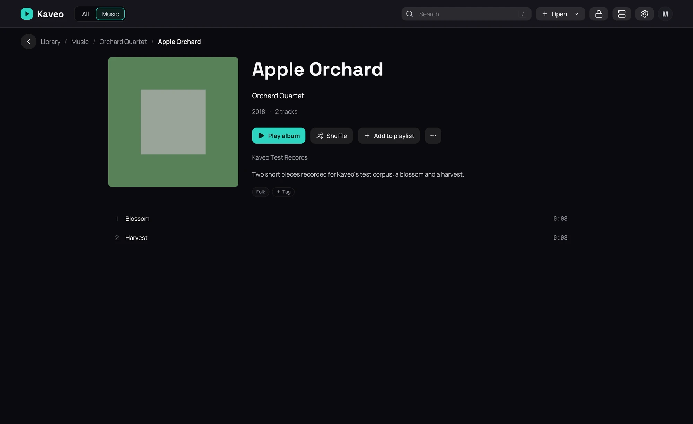

## What it is for

Fill in what an album's tags leave out — its year, label, genres, how many tracks it has, and a
missing cover — without changing your files.

## How to use it

1. An *album.nfo* in the album's folder — written by Kodi, Jellyfin or Lidarr — is read by itself.
2. Kaveo looks albums up on MusicBrainz and fetches missing covers from the Cover Art Archive. To
   stop it, turn off **Album information online** in **Settings › Metadata** and click **Save**.
3. If an album is matched wrongly or not at all, click **⋯** › **Identify album…** on its page, click
   the right one and **Use this match**, or choose **None of these**.
4. Click **⋯** › **Write album.nfo** to save what Kaveo knows beside the album.

## Good to know

- Your tags always win; the rest only fills what they leave empty.
- An album is used only when exactly one match is found. Album titles and artist names are sent.
- Free keys add more, each from the service's **Get a free key** link: covers from fanart.tv,
  Discogs and TheAudioDB, descriptions from TheAudioDB and Last.fm, and AcoustID recognises an
  album by its sound (it needs *fpcalc*).
- Last.fm and AcoustID allow non-commercial use only; entering a key accepts their terms.
- An *album.nfo* Kaveo did not write is never replaced.
- Albums on a Jellyfin server keep the server's information.
