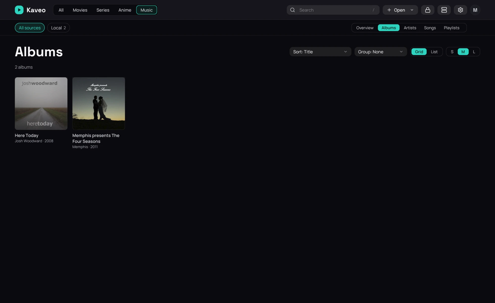

## What it is for

A music category has tabs at the right of the bar under the categories: **Overview** is the page
of rows, **Albums**, **Artists**, **Songs** and **Playlists** each show all of one kind.

## How to use it

1. Open the **Music** category and click **Albums** — or the title of the **Albums** row.
2. Choose how they are sorted (**Title**, **Artist**, **Year**, **Recently added**) and grouped
   (**None**, **Artist**, **Year**, **Genre**).
3. Switch between **Grid** and **List**; in the grid, **S**, **M** and **L** set the card size.
4. Click an album to open it.

## Good to know

- Your choices are kept, and the card size is the same as **Card size** in
  [Layout](../settings/layout.md): it sizes every row and grid of the library.
- The **Artists** tab offers **Grid** and **List** too; **Songs** is a table of its own
  ([Songs](songs.md)).
