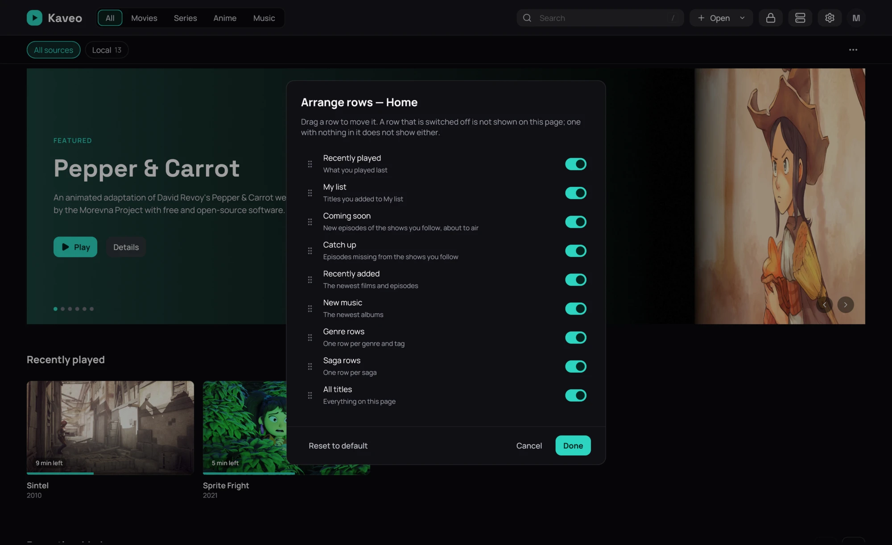

## What it is for

Each page of the library — the home and every category — shows its titles in rows. You decide which
rows it shows and in which order.

## How to use it

1. Click **⋯** at the right end of the bar under the categories, then **Arrange rows…**.
2. Drag a row by its handle to move it; turn its switch off to hide it.
3. Click **Done**. **Cancel** leaves the page as it was; closing the dialog with changes in it asks
   first.

To hide a single row straight away, right-click its title and choose **Hide this row**.

## Good to know

- Each category has its own arrangement; a source pill shows the arrangement of the page it is on.
- A row with nothing in it does not show, whatever its switch says.
- A genre row you hid comes back from **Arrange rows…**, under the list.
- **Reset to default**, or **Reset rows** in the **⋯** menu, puts the page back as Kaveo ships it.
