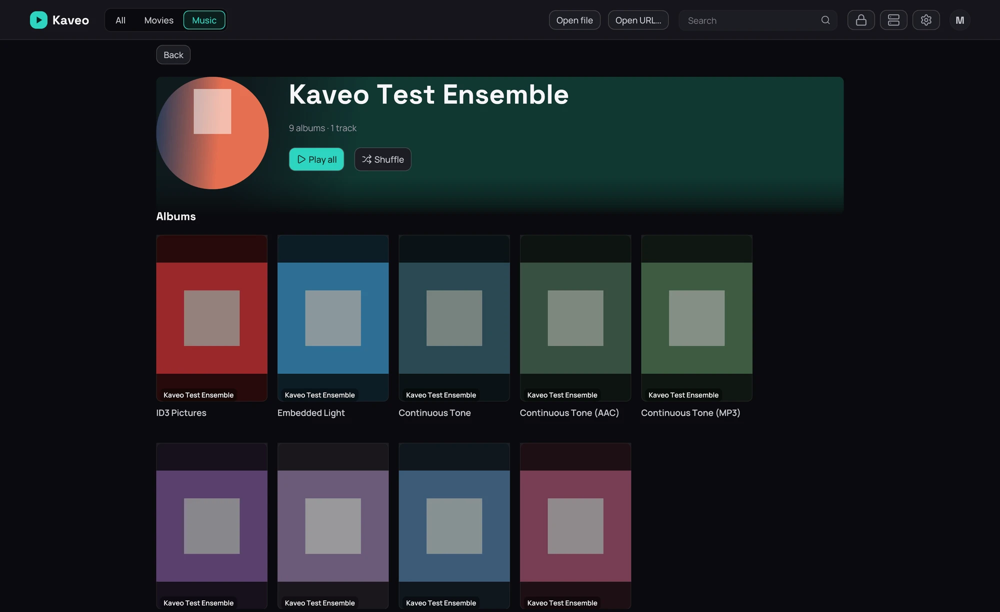

## What it is for

Show each artist's picture on their page, in the artists list and in a search — from your own files
first.

## How to use it

1. In the folder named after the artist, beside their album folders, put *artist.jpg* or
   *folder.jpg*; a *backdrop.jpg* there fills the band behind their name.
2. With a Jellyfin server, the pictures it holds for an artist are used next.
3. For the rest, Kaveo looks online. To stop it, turn off **Artist pictures online** in
   **Settings › Metadata** and click **Save**.
4. To delete the pictures found online, click **Clear** beside **Downloaded artist pictures**.

## Good to know

- Online pictures come from MusicBrainz and Wikimedia Commons, which receive the artist names and
  album titles.
- A picture is used only when one of the artist's albums confirms who they are, so an artist with
  only loose songs keeps the placeholder.
- An online picture's author and licence are shown under the artist's name; the licence opens the
  picture's page.
- With a free fanart.tv or TheAudioDB key in **Settings › Metadata**, their pictures come after
  these, and a biography from TheAudioDB or Last.fm appears under the name.
