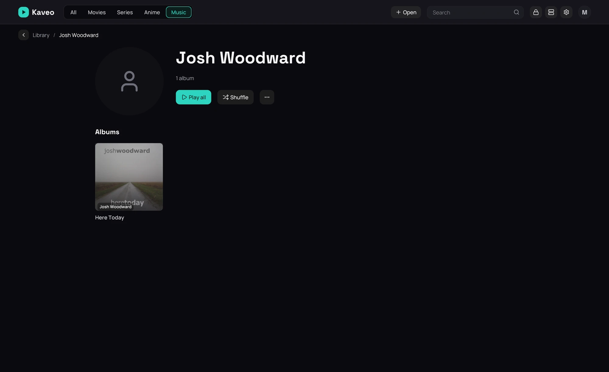

## What it is for

See every artist in your music, open one to find their albums and the songs they sing on other
albums, and play all of it at once.

## How to use it

1. Open the **Music** category; the **Artists** row comes first, before the albums.
2. Click an artist, or click the row's title to see every artist.
3. On an artist's page, click **Play all** or **Shuffle**, or open one of their albums.
4. On an album page, click the artist's name to go to their page.

## Good to know

- **Appears on** lists the albums of others, and the compilations, with a song by this artist;
  **Play all** plays only their songs from those.
- An album whose songs are by different artists is one album by *Various Artists*, even when its
  files do not say so, as long as its songs share an album name and a folder.
- An artist with no picture of their own shows a placeholder: see
  [Artist pictures](artist-pictures.md).
