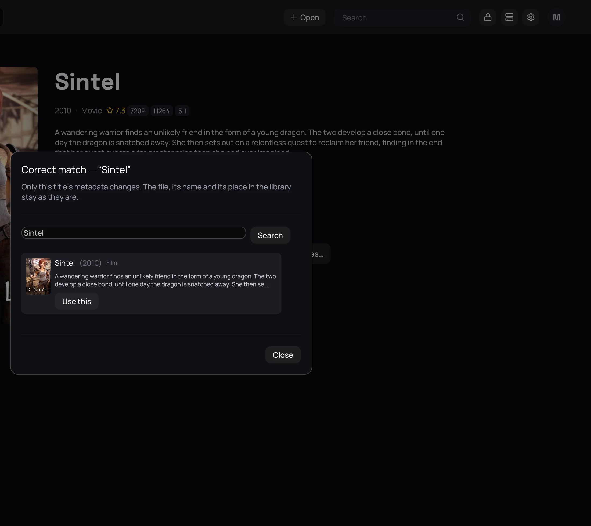

## What it is for

When a poster or a plot belongs to something else, Kaveo has matched a local title to the wrong film
or series — correct it by hand.

## How to use it

1. Right-click the card and choose **Correct match…**, or click **⋯** on the title's page and choose it there.
2. If the right one is not shown, look under **What Kaveo read** — the name the file had before import, the title in the file, the file and its folder — and click the magnifier beside one to search for it, or type your own and click **Search**.
3. Click a candidate to read more about it beside the list — **View on TMDB** opens its page — then click **Use this match**.
4. If the title is on no online service at all, click **No match** instead: Kaveo keeps the name its files give and stops looking it up.

## Good to know

- The match is pinned, so no later scan can undo it.
- Only the metadata changes — the file, its name and its place in your library stay put. To see everything a file says about itself, choose **File info…** from the same menu.
- To hand the decision back to Kaveo, open the same dialog and click **Restore automatic match** — it undoes **No match** too.
