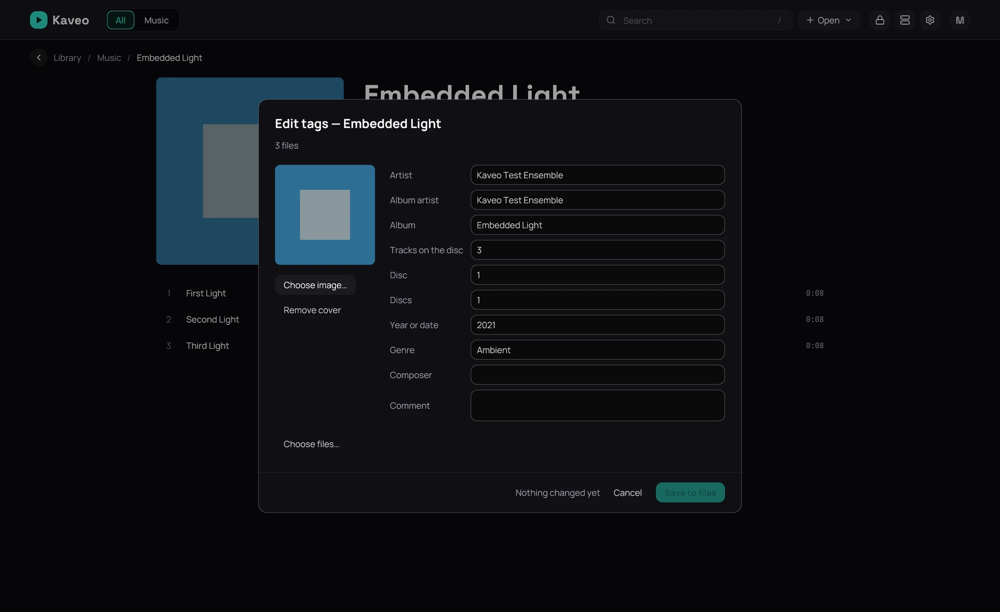

## What it is for

Correct the tags inside your music files, so Kaveo and every other player show the same thing, and
store the loudness Kaveo measured in them.

## How to use it

1. On an album's or an artist's page, click **⋯** › **Edit tags…**; for one song, use its menu.
2. Change the fields. With several songs, a field reading *Multiple values — type to replace them all* stays as it is unless you type in it.
3. Click **Save to files**.
4. To store loudness, click **⋯** › **Write ReplayGain tags…** on an album's or an artist's page, then **Write tags**.
5. To undo a write, click **⋯** › **Restore previous tags…** where you made it, choose it, then **Restore**.

## Good to know

- Only what changes is written, a file is never left half-written, and a file changed since a write is not restored.
- In **Identify album…**, **Use this and write to the files…** shows every change first; a song placed on a track with another title starts unticked.
- DSF, DFF, MKA, WMA and AC3 files, and songs on a Jellyfin server, are listed and left alone.
