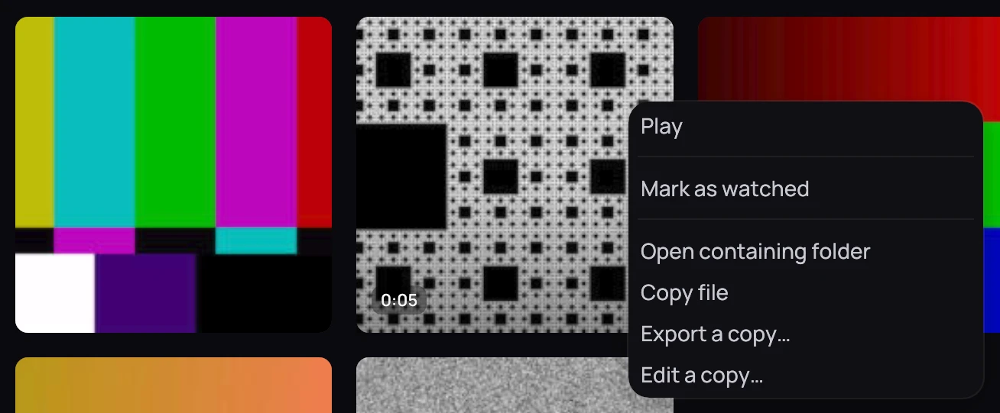

## What it is for

Copy your own photos and videos somewhere else — a USB stick, a shared folder — keeping the date
each was taken. The photos and subtitles named after a video go with it, and a Live Photo's motion
goes with its photo.

## How to use it

### One photo or video

1. Right-click its card on its folder's page, the photo in the viewer, or the picture while a video
   plays.
2. Choose **Export a copy…** and pick a folder.

### A whole folder

1. Open the folder's page and click **Export folder…**, or right-click the folder's card.
2. Pick where to put it: Kaveo makes a folder with the same name there.

### A folder on a network connection

With a connection set up in Settings › Library › Network, the export first asks **where**: *This
computer*, or the connection and the folder inside it (empty means its base folder).

## Good to know

- The progress shows at the top of the library. Click the cross beside it to stop: what is already
  copied stays, and a message says where the copies are.
- Nothing is ever replaced. On this computer a taken name gets a number and a copy already there is
  skipped; on a connection a taken name stops the export.
- Private videos and ripped discs are left out, and the message says how many. A folder inside the
  one you export has its own card.
- A connection makes no folder: the one you type has to exist already.
