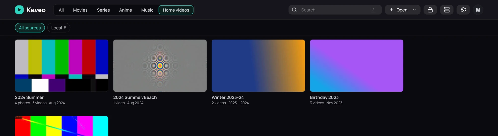
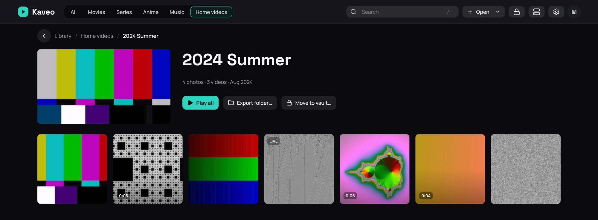

## What it is for

A personal category holds your own photos and videos, from a phone or a camera, in the folders you
already made — and those folders can hold other folders. They never appear on the home or among
films and series.

## How to use it

1. In **Settings › Library › Categories**, add a category, tick **Personal**, then **Add folder…**
   and pick the folder of your photos and videos.
2. Click the category at the top of the library: one folder opens straight onto its content, several
   ask which first. The breadcrumb above the page is the path you are in.
3. A folder shows its subfolders first, then its photos and videos, newest first. Click a video to
   play it, or **Play all** — a [slideshow](slideshow.md) once the folder holds a photo.
4. **Folders / All** switches between the tree and one flat list of every photo and video in the
   place you are in. Kaveo remembers the choice for the category.
5. **New folder** creates a subfolder on disk.
6. Click a photo to open it on its own — see [Viewing photos](view-photos.md).

## Good to know

- Kaveo never renames, moves or looks up your photos and videos online, and never files downloads
  here.
- A photo's date is the camera's, or else the file's own.
- A Live Photo carries a **LIVE** badge; its short video stays with it.
- AVCHD camera files are not shown yet.
