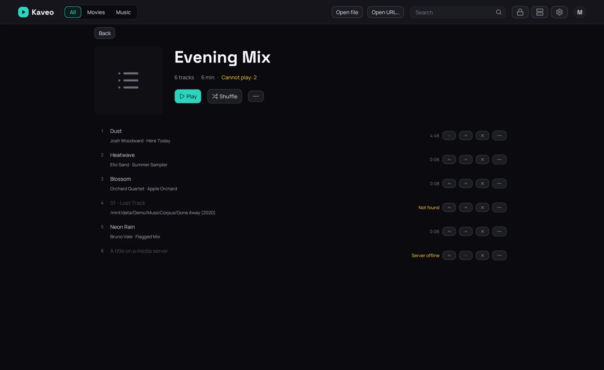

## What it is for

Gather songs from any album into a list of your own, and play it whenever you like.

## How to use it

1. In any song's menu, choose **Add to playlist**, then a playlist or **New playlist…**. An album
   page has the same button for the whole album.
2. Open the **Music** category: the **Playlists** row sits under *Artists*. Click its title to see
   them all.
3. On a playlist's page, click **Play** or **Shuffle**, or a song to start from it.
4. Reorder with the arrows, or take a song out with the cross.
5. In the queue, **Save as playlist…** keeps what is playing.

## Good to know

- **Import playlist…** reads an M3U file. Songs that moved are looked for in your library; web
  addresses are left out, and Kaveo tells you which.
- An M3U file dropped on the window, opened with **Open file**, or opened with Kaveo from your
  [file manager](../file-manager.md) plays at once; **Save as playlist…** in the queue keeps it.
- A song that is not on disk stays, marked **Not found**, and is skipped when the playlist plays.
- **Export as M3U…** writes a file other players read. Songs only on a server are left out.
- A [Jellyfin server](../sources/jellyfin.md)'s playlists appear under its name. They play here but
  change only on the server; **Save a copy to my playlists** gives you one you can edit.
