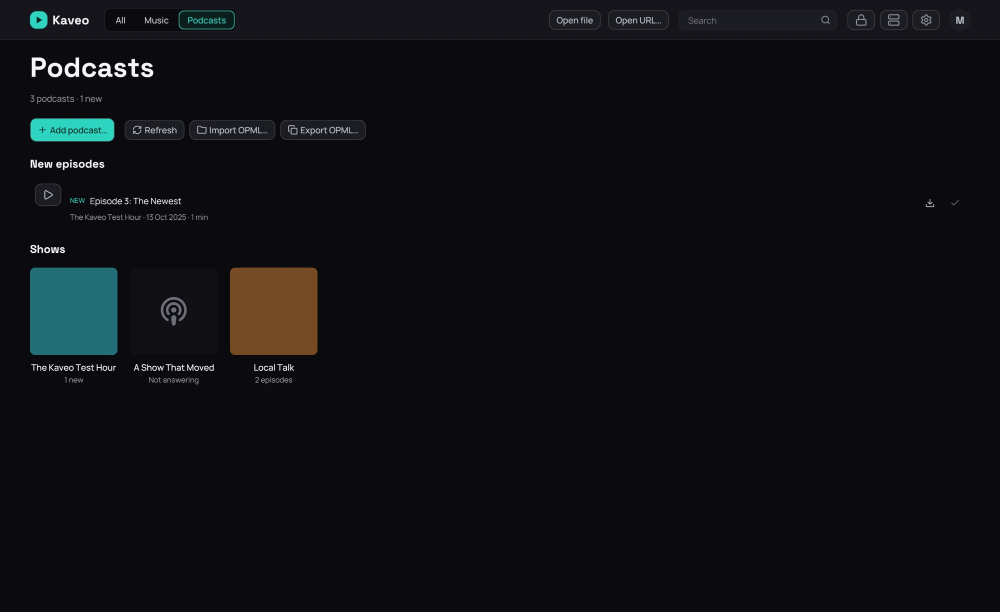

## What it is for

Follow podcasts without an account: Kaveo reads each show's RSS feed and lists its episodes.

## How to use it

1. In **Settings › Library › Categories**, tick **Podcasts** on a category. That category is your
   podcasts page.
2. On it, click **Add podcast…** and paste the feed's address, or **Import OPML…** to bring your
   subscriptions from another app.
3. Open a show and click **Play** beside an episode. It streams; **Download** keeps a copy, which
   plays from then on.
4. An episode resumes where you stopped, and is marked played once you have heard 90% of it.

## Good to know

- A folder of episodes in one of the category's folders becomes a show of its own.
- Feeds are checked when Kaveo starts and every six hours; **Refresh** checks now.
- A feed that stops answering says so; its episodes stay listed and Kaveo keeps asking.
- Downloads go to the folder set in **Settings › Library › Folders**.
- Speed and chapters work as for any other track.
