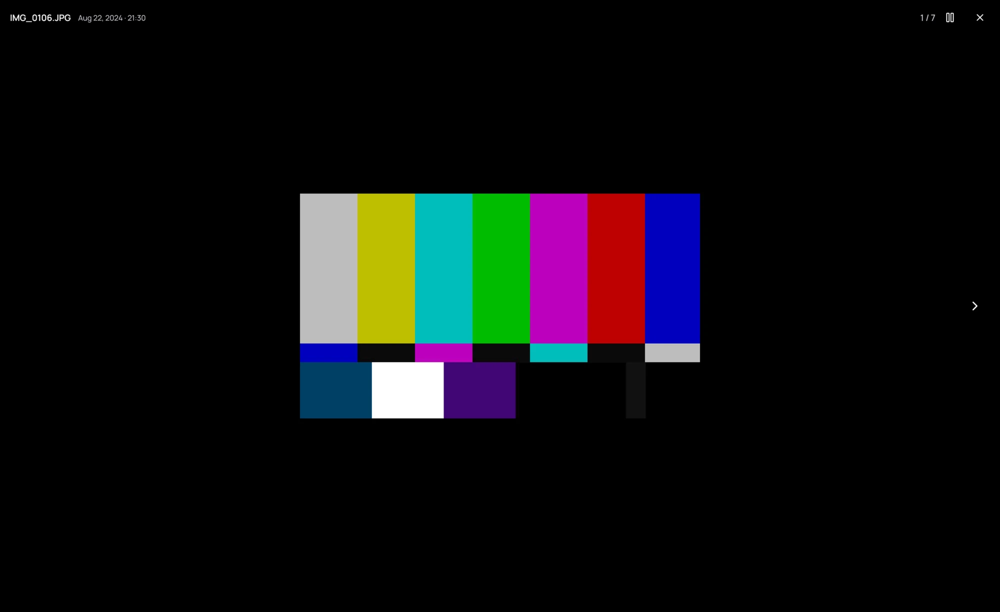

## What it is for

**Play all** on one of your own folders that holds photos shows it as a slideshow, newest first:
each photo stays on screen for a few seconds, and each video plays to its end.

## How to use it

1. Open the folder and click **Play all**.
2. A photo stays for the time set in **Settings › Interface** — five seconds unless you change it. A
   Live Photo plays its motion once, without sound, before the slideshow moves on.
3. A video opens in the player, and the slideshow carries on when it ends.
4. Press **Space**, or click the pause button at the top right, to pause; press it again to carry
   on.
5. Press **Esc** to return to the folder.

## Good to know

- **Esc** in the player stops the slideshow on that video, paused. Press **Space** to play it and
  carry on.
- **→** and **←** still move through the folder by hand, and the slideshow goes on from there.
- The slideshow stops on the last photo or video rather than starting over.
- While it runs, your screen does not go to sleep.
- A folder of videos only plays them one into the next, as before.
