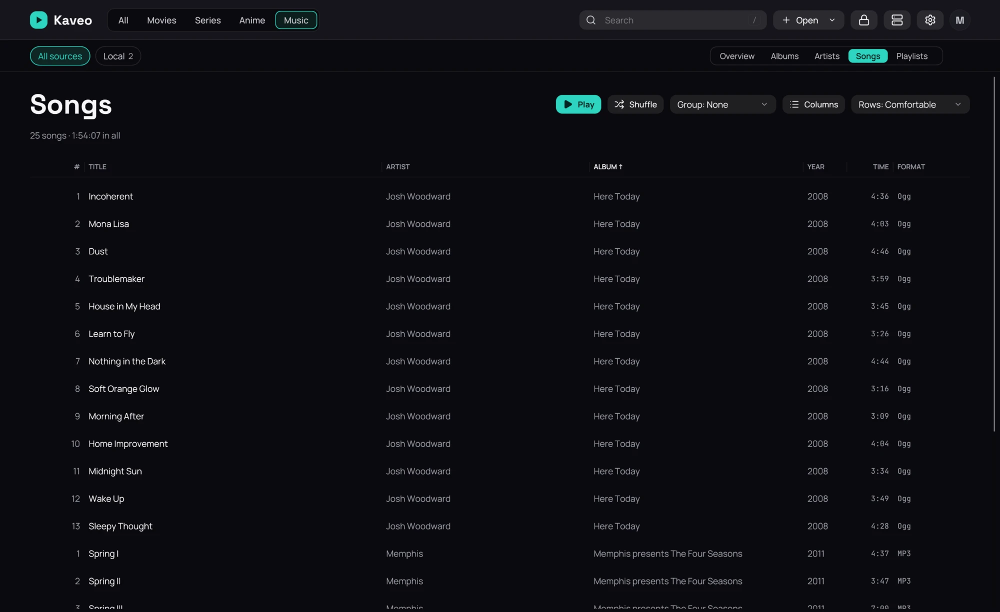

## What it is for

The **Songs** tab of a music category lists every song as a table: one line per song, sorted and
laid out your way.

## How to use it

1. Open the **Music** category and click **Songs**.
2. Click a column's heading to sort by it; click it again to reverse the order.
3. Drag a heading to move its column, or the edge between two headings to resize it.
4. Choose the columns under **Columns**, or with a right-click on the headings.
5. Set **Group** to **Album** to see each album under its own heading.
6. Set **Rows** to **Compact** to fit more songs on screen.
7. Point at a song and click the play button at its left, or double-click it, to play from that song.
8. Click **⋯** at its right, or right-click it, for the same menu as an album's songs.

## Good to know

- Your columns, their widths and the order are kept. **Reset columns** brings back the first ones.
- When the songs are grouped by album, the **Album** and **Album artist** columns are left out: the
  heading already says it.
- **Rows** sets the height of every list of songs: albums, artists, playlists and searches too.
- **Play** and **Shuffle** play every song on the page, in the table's order or mixed.
