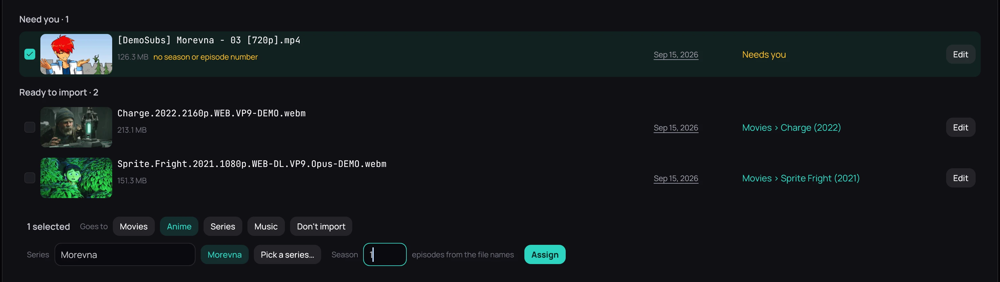

## What it is for

Kaveo does not guess. A file it cannot name waits under *Need you* in the import window, and nothing
moves until you say where it belongs.

## How to use it

1. Tick the files that belong together: **Shift**+click ticks a run, and a row's date ticks every
   file from that day.
2. Under **Goes to**, click one of your categories — or **Don't import**.
3. Answer what it asks: a folder for your own videos (**New folder** suggests a name from the
   dates), or the series and the **Season** for episodes.
4. Click **Assign**. The rows move to *Ready to import* and say where they will be filed.

## Good to know

- **Edit** opens every detail of one file, such as a film's title and year; **Edit…** in the bar
  edits the ticked files together, a value written once applying to them all.
- **Search** beside a title looks it up online; **Use this match** fills it in.
- **Don't import** leaves files in the download folder; **Don't ask again** stops Kaveo mentioning
  them at the next launch.
- A folder you name here is created only when you import.
- **{MediaInfo …}** tokens are read from the file: check that FFprobe is installed.
- Samples and bonus material are never imported, and a file still downloading is left out.
