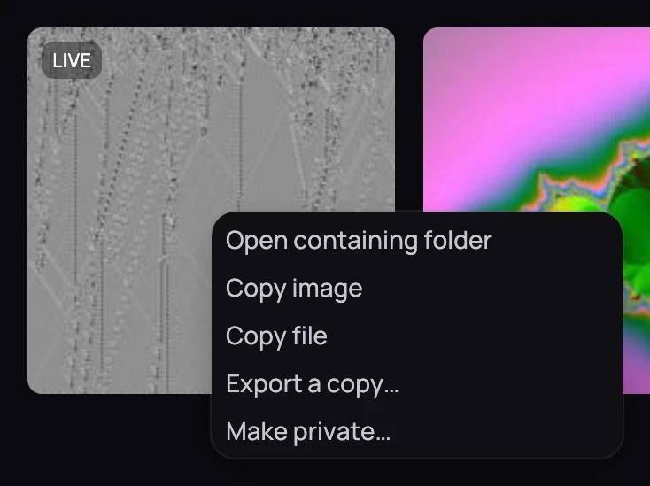
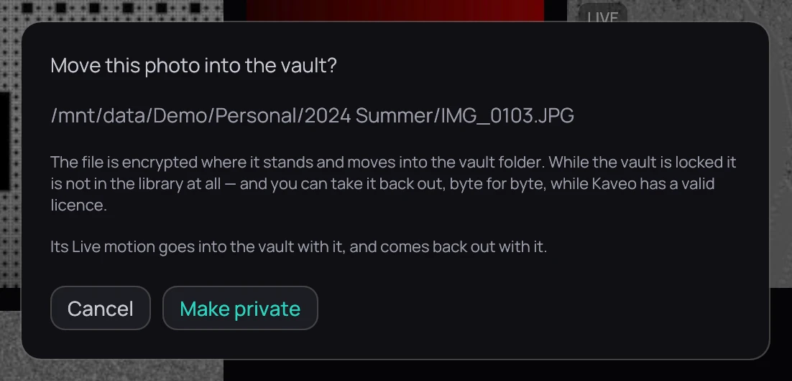

## What it is for

Move one of your own photos into the vault — encrypted, and out of your library while the vault is
locked.
A Live Photo's motion goes in with it.

## How to use it

1. Right-click a photo on its folder's page and choose **Move to vault…**. Kaveo
   [creates](set-up.md) or unlocks the vault first if needed.
2. Check the path, then click **Move to vault**.
3. Or drop the photo into your private folder: Kaveo hides it, and the video of the same name
   beside it as its motion.

## Good to know

- While the vault is unlocked, the photo stays in its folder at its date, and opens in the viewer
  as before — its motion too. A slideshow leaves it out.
- Its picture is never kept anywhere unencrypted, not even its small preview: Kaveo makes it again
  after each unlock.
- A private photo offers no copies. Take it back out to copy or export it — see
  [Taking a title back out](take-a-title-out.md); it comes back with its motion and its dates.
