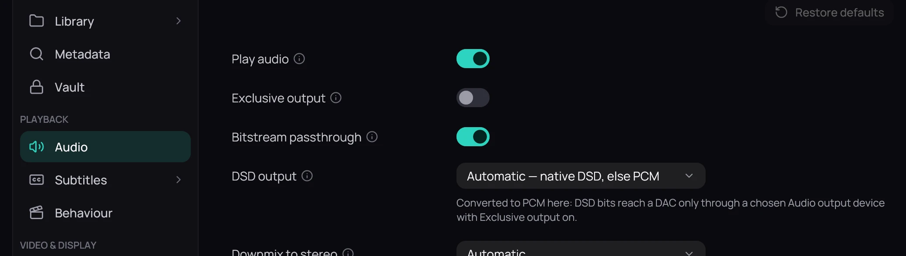

## What it is for

**Settings › Audio** decides where the sound goes and how special formats reach it.

## How to use it

1. **Exclusive output** with a chosen **Audio output device** is bit-perfect, bypassing the mixer.
2. **Bitstream passthrough** sends Dolby and DTS to a receiver untouched.
3. **DSD output**: DSF and DFF reach a DAC as DSD only on a chosen device with **Exclusive output**.
4. **Downmix to stereo**: **Automatic** folds only for a narrower output (an HDMI receiver is asked).
5. **Volume control** on **Output device** is bit-perfect below 100 %
   ([Volume](../watching/volume-and-dynamics.md)).
6. **Sync offset for this output** corrects a late output, like a headset.
7. **Preferred audio languages**: **Add language**, best first; drag to reorder.
8. **Keep pitch when changing speed**: off, faster sounds higher, like a tape.

## Good to know

- **DoP (DSD over PCM)**: only for a DAC that decodes it; others play noise. With DSD to the
  DAC, volume, the equalizer, crossfade and the visualizer do not apply.
- **Audio output device** lists the sound server's outputs too, a Bluetooth one marked: they play
  through the server in PCM, so **Exclusive output** and **Bitstream passthrough** do not apply.
- A rate the device lacks is converted and reported.
- A title opens on the first of those languages it has, or its series' one; never a commentary or an
  audio description.
- A non-HDMI pin makes **Automatic** stand down; **Use a different setting for this output** gives it
  a rule.
- Everything waits for **Save** ([Saving changes](saving.md)).
