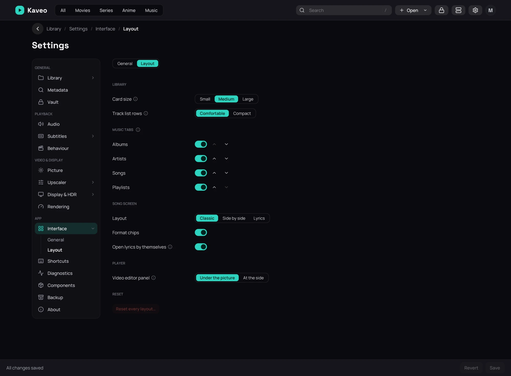

## What it is for

**Settings › Interface › Layout** gathers how the library and the song screen are arranged — the
same choices you can make where you see them — and the one button that puts them all back.

## How to use it

1. Open **Settings › Interface** and click **Layout**.
2. Set **Card size** and **Track list rows** (**Comfortable** or **Compact**).
3. Under **Music tabs**, turn a tab off to hide it, and use the arrows to move it. **Overview** is
   always first.
4. Under **Song screen**, pick a **Layout** and turn **Format chips** and **Open lyrics by
   themselves** on or off. Under **Player**, set where the **Video editor panel** sits.
5. Click **Save**.

## Good to know

- The same choices are also in the library's toolbars, the **⋯** menu of a page's rows, and the
  player's **⋯** › **Layout**: there they apply at once.
- **Reset every layout…** puts every page's rows, the music views, the Songs table and the song
  screen back as Kaveo ships them. It asks first, applies at once, and cannot be undone.
- A hidden tab can still be opened from its row's title on **Overview**.
