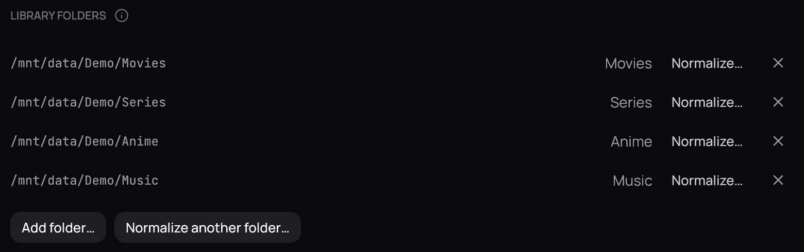

## What it is for

**Settings › Library** holds what is in your library and what it is called. Its four sub-pages —
**Folders**, **Categories**, **Naming** and **Network** — appear in the rail and as tabs.

## How to use it

1. Open **Settings › Library › Folders** for the groups: **Library folders**
   ([Local folders](../sources/local-folders.md)), **Download folders**
   ([Download folders](../organizing/download-folders.md)), **Private folder**
   ([Hiding a title](../private/hide-a-title.md)) and **Adult content**
   ([Hiding adult content](../library/adult-content.md)). **Normalize another folder…**, beside
   **Add folder…**, tidies one you pick — [Tidying a folder](../organizing/tidy-a-folder.md).
2. Open **Categories** for libraries of your own, with their folders and content kinds —
   [Categories](../library/categories.md).
3. Open **Naming** for the groups **Options**, **Movies**, **TV Series**, **Anime** and
   **Music naming**, the **Standard**, **Plex** and **Kodi** presets and the **Available tokens**
   reference — [Naming templates](../organizing/naming-templates.md).
4. Open **Network** for a folder on another machine — [Network folders](../library/network-folders.md).
   **Add connection…**, fill in its address, and **Test** it; only **WebDAV** works, the others are
   greyed out.
5. At the foot of **Folders**, **Clear history…** empties *Recently played* once confirmed; it
   is greyed out with nothing to clear.

## Good to know

- Three things do not wait for **Save**: **Categories** applies and rescans at once, a connection
  is written by its own form, and **Clear history…** empties the list once confirmed. **Revert**
  undoes none of them.
- Clearing the history cannot be undone, but it does not forget where you stopped in a film.
