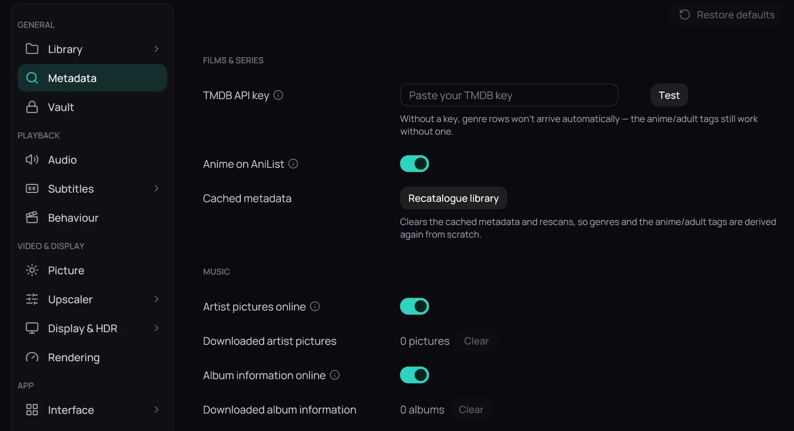

## What it is for

**Settings › Metadata** holds the key Kaveo uses to fetch posters, plots and genres, and the one
button that throws all of that away and fetches it again.

## How to use it

1. Paste your key into **TMDB API key**, then click **Test key** — it answers *Key works*, or names
   what went wrong.
2. Click **Save** to keep it: **Test key** only asks, and nothing reaches your key store before you
   save.
3. When a trailer or a web video asks you to sign in, sign in to that site in your browser and
   choose the browser under **Site cookies** — and, if it has several, the profile under **Browser
   profile**. **Test** checks that Kaveo can read it. If not, choose **cookies.txt file…**.
   Previews are chosen under [Interface](interface.md).
4. Click **Recatalogue library** to forget every cached poster, plot and genre and fetch them again.

## Good to know

- **Recatalogue library** acts at once; **Revert** does not undo it.
- Kaveo reads the cookies only when a video needs them, and keeps no copy. On Windows, Chrome, Edge
  and Brave cannot be read; Firefox can, once closed.
- On Linux, reading Chrome or Vivaldi takes about 3 seconds, Firefox under one. *python-pycryptodomex*
  on Arch (*python3-pycryptodomex* on Fedora) brings them under one.
- With no key, only the genre rows stay empty: see [Genres and tags](../library/tags.md).
- A wrong poster or plot is corrected on the title: see
  [Correcting a wrong match](../library/correct-a-match.md).
