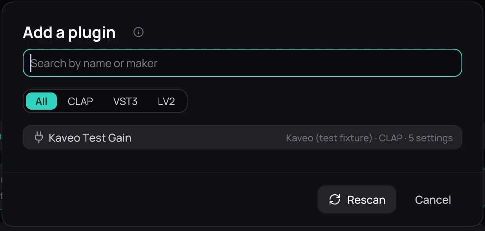

## What it is for

A plugin is an audio effect made by others, in the CLAP, VST3 or LV2 format. Kaveo runs it as a stage on
the [Effects](effects.md) page.

## How to use it

1. Install free plugins from your distribution: *lsp-plugins*, *x42-plugins*, *calf* and
   *zam-plugins* on Arch; *lsp-plugins*, *x42-plugins*, *calf-plugins* and *zam-plugins* on Debian.
2. Or download one from its maker's site and put it in *~/.clap*, *~/.vst3* or *~/.lv2*.
3. On the Effects page, choose **Add stage**, then **Plugin…**, and press **Rescan**.
4. Pick the plugin; its card shows its settings.

## Good to know

- Only stereo effects are listed, and each runs in a process of its own: if it crashes, the music
  keeps playing.
- Kaveo shows a plugin's settings itself and opens no plugin window.
- Plugins are not available on Windows yet.
