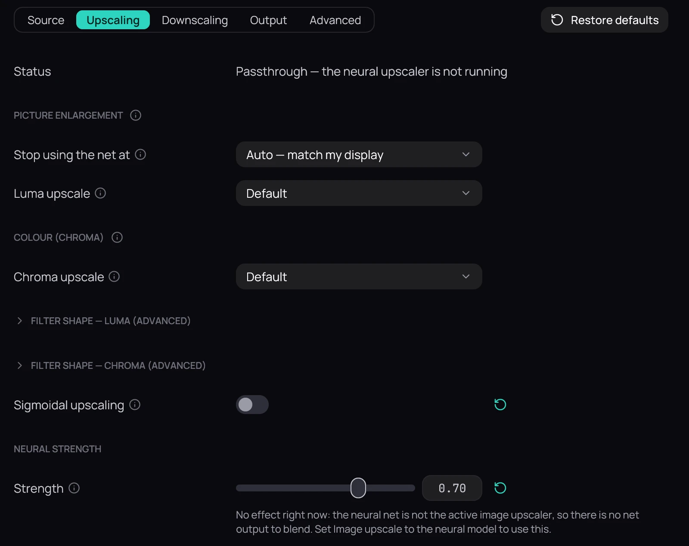

## What it is for

When you have changed a setting and no longer remember what it was, Kaveo can put it back the way
it ships — one setting at a time, or everything on the page you are looking at.

## How to use it

1. A setting you have changed shows a round arrow at the end of its row. Click it to put that one
   setting back.
2. **Restore defaults**, at the top right of a page, puts back every setting on that page — on a page
   with tabs, only the tab you are on. It is greyed out when everything is already at its default.
3. Nothing is kept until you click **Save**, and **Revert** takes it all back — see
   [Saving changes](saving.md).

## Good to know

- Some things are never restored, because they are choices rather than adjustments: the language,
  the upscaler's models and the transcriber's model, the audio device and an output's own profile,
  accounts and keys, folders, and what is installed on **Components**.
- On **Display & HDR**, the defaults go into the display profile you are editing; the profile itself
  is kept.
- **Audio › Effects** has no page-wide button: a chain is your own setup — its cards, their files, a
  plugin's parameters — so each value with a default carries its own arrow, and a plugin's go back
  with the card's own **Reset**.
- **Interface › Layout** keeps its own **Reset every layout…**, which also puts back the rows you
  arranged on the library's pages — see [Layout](layout.md).
