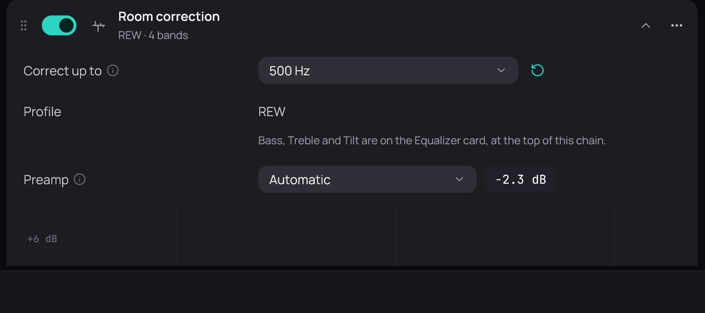

## What it is for

A room makes some bass notes boom and others vanish. Measure it once, and Kaveo evens it out at the
listening seat.

## How to use it

1. In REW (Room EQ Wizard), measure a sweep with a calibrated microphone at your listening seat.
2. In its EQ window, choose the Generic equaliser and press *Match Response to Target*.
3. From REW's File menu, choose *Export filter settings as text* or *Export filters impulse response as WAV*.
4. In Kaveo, choose **Correct my room…**, then **File…**, and pick that file.
5. Leave **Correct up to** at **500 Hz** at first; raise it only if it sounds better.

## Good to know

- Below 500 Hz the room dominates and a measurement is reliable; above it, a full correction often
  sounds dull.
- **Set by hand** starts the same card with no bands, to enter them yourself.
- One measurement is for one seat and one pair of speakers.
