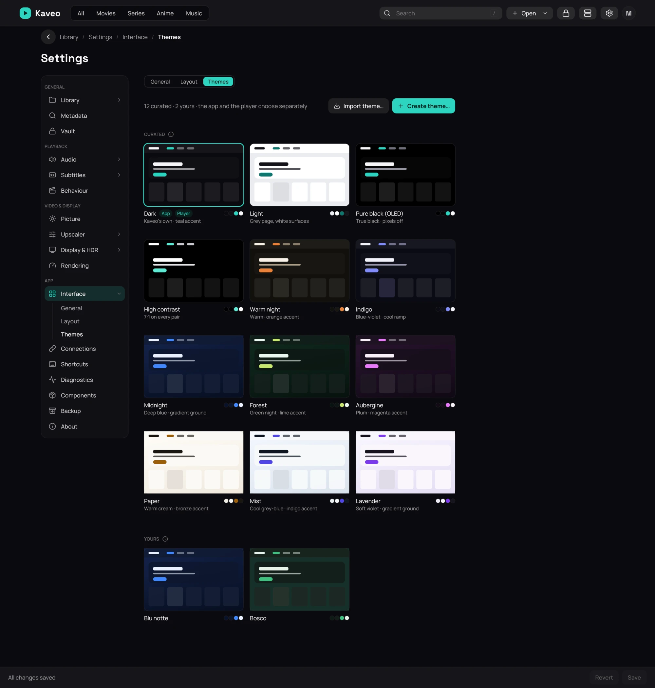

## What it is for

**Settings › Interface › Themes** shows each theme as a small picture of its look. Kaveo comes with
twelve, six on a coloured background. The library and the player each have their own.

## How to use it

1. Open **Settings › Interface** and click **Themes**.
2. Point at a card, click **Use for the app** or **Use for the player**, then **Save**.
3. Click **Create theme…**, or **Duplicate** on a curated card.
4. Pick a **Page colour**, a **Text colour**, an **Accent colour**, a **Contrast** and a
   **Background**: **None**, **Colour**, **Gradient**, **Artwork** or **Picture**. The preview
   follows every change.
5. Click **Save theme**, or **Cancel** to throw the changes away.
6. To share one of yours, open it and click **Export…**. To add one, click **Import theme…**,
   check its preview and click **Import**.

## Good to know

- A picture is copied into the theme. Kaveo dims a bright one until text stays readable.
- The import preview shows how readable a theme is. If the name is taken, choose **Import as copy**
  or **Replace mine**. A curated theme is duplicated, then exported.
- **Delete** cannot be undone. A theme in use is switched to **Dark** first.
- A backup includes your themes. One that cannot be restored is named, with the reason.
