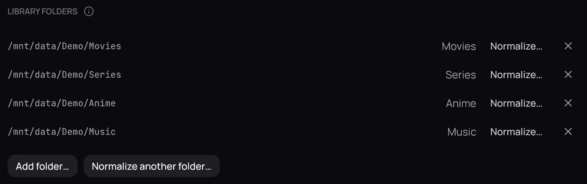

## What it is for

The folders Kaveo scans on this computer, for films, series and music. Every folder belongs to a
category: one added here goes into *Library*, a category made the first time that takes
everything and stays the one, however you rename it, as long as it accepts every kind. To file a folder under *Movies* or *Series*,
add it to that category instead, see
[Categories](../library/categories.md).

## How to use it

1. Open **Settings › Library › Folders** — every folder is listed under **Library folders**, with
   its full path and its category.
2. Click **Add folder…** and choose another folder to scan.
3. Click the cross (**Remove**) beside a folder to stop scanning it, or **Normalize…** to rename what
   is in it — see [Tidying a folder](../organizing/tidy-a-folder.md).
4. Click **Save** — the scan runs then, not before; **Revert** puts the list back.

## Good to know

- Removing a folder touches no file on disk and asks nothing: its titles leave the library, and its
  *Recently played* cards stay. Right-click one and choose **Remove from Recently played**, or clear
  them all with **Clear history…** under **Settings › Library › Folders**
  ([Library](../settings/library.md)).
- Kaveo takes video files, and audio files as music; samples and bonus material are left out, and
  so is anything you leave out yourself — see [Leaving files out](leave-out.md).
- Nothing needs rescanning by hand — a new file appears on its own, about ten seconds later. On a
  network folder Kaveo cannot watch, it appears the next time Kaveo starts.
