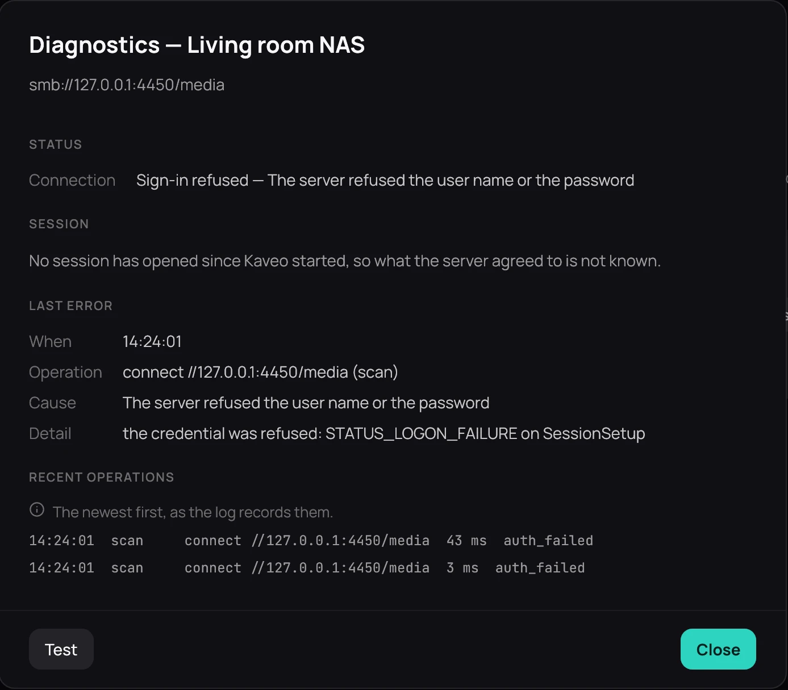

## What it is for

When a network folder does not work, its diagnostics show what Kaveo asked the server and what it
answered: enough to tell a wrong password from a missing share or a server that is off.

## How to use it

1. Click **Sources**, then **Diagnostics** on the connection's card.
2. **Status** says whether the connection works, and why not. **Test** asks the server again.
3. **Session** shows what the last connection agreed, such as the SMB dialect or the TLS version.
4. **Last error** and **Recent operations** list what was asked, newest first.

## Good to know

- No password is ever shown.
- What Kaveo has not seen is said, never guessed.
- From a terminal, kaveo-ctl reads the same, and can never change a connection.
