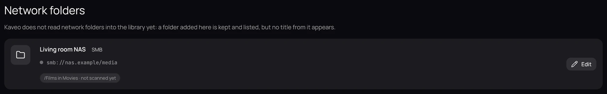
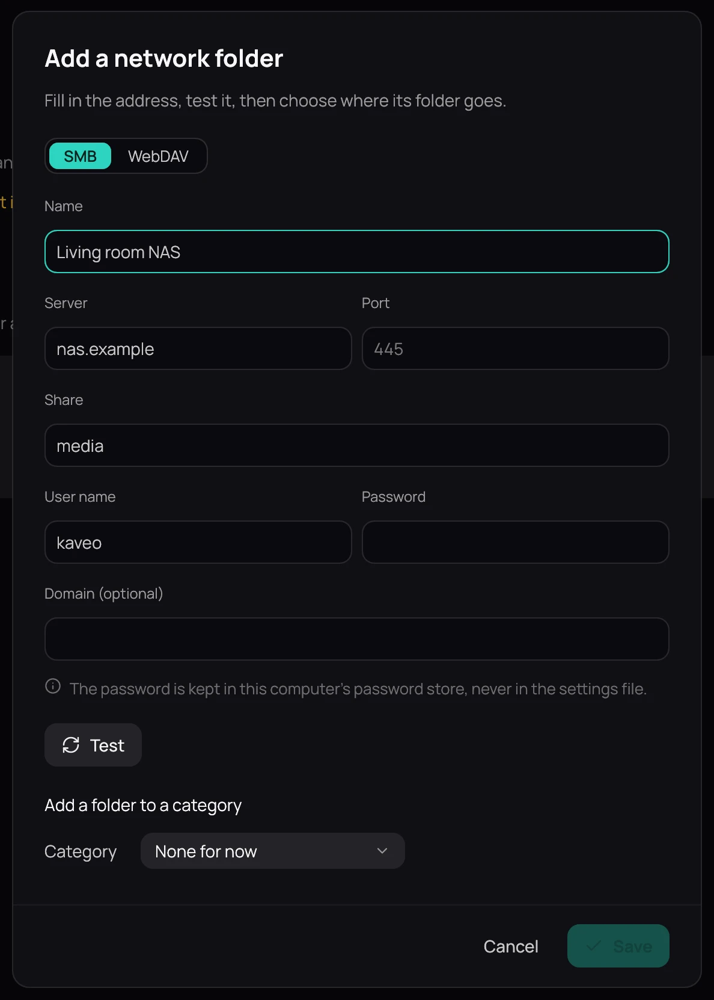

## What it is for

Kaveo keeps a shared folder on your network — an SMB share or a WebDAV folder — as a folder of one
of your categories.

## How to use it

1. Click **Sources**, then **Connect a server** and **SMB** or **WebDAV**.
2. Fill in **Server**, **Share** (or **Folder on the server**), **User name** and **Password**.
3. Click **Test**, and answer if Kaveo asks you to trust something.
4. Pick a **Category**, type the **Folder (empty for the whole share)**, and click **Save**.

## Good to know

- Network folders are not read into the library yet: no title from them appears.
- The password stays in your computer's password store.
- A new server address asks whether it is the same server; **Same server** keeps where you stopped.
