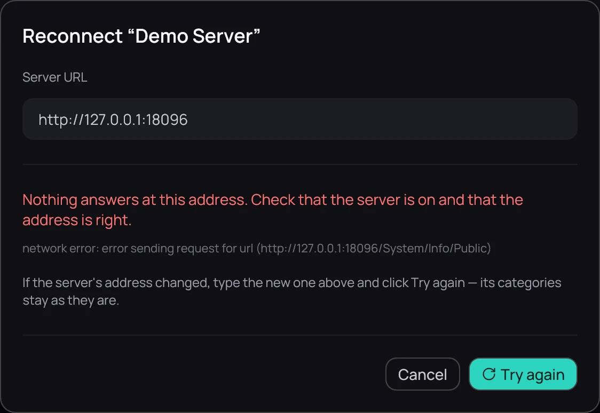

## What it is for

A server whose address changes — a new router, a new IP — stops answering at the old one. Kaveo
keeps every category the server fed; it only needs the new address.

## How to use it

1. Click **Sources** in the top bar. The server's card says *No answer*.
2. Click **Reconnect**. Kaveo tries the old address and says nothing answers there.
3. Type the new address in **Server URL** and click **Try again**. Kaveo checks that it is the same
   server, and its titles come back.

Connecting it again from **Connect a server** works too: Kaveo recognises the server, updates its
address and keeps its categories.

## Good to know

- An address with no scheme and no port gets Jellyfin's usual ones: *10.0.0.5* becomes
  *http://10.0.0.5:8096*.
- If the server answers only with the other scheme, Kaveo says so and offers that address.
- A server listed twice, at its old and its new address, becomes one entry as soon as the new one
  answers: its titles stop appearing twice, and a message says which address Kaveo kept.
- *Checking…* on a card means Kaveo is still asking the server; a large library can take a minute.
