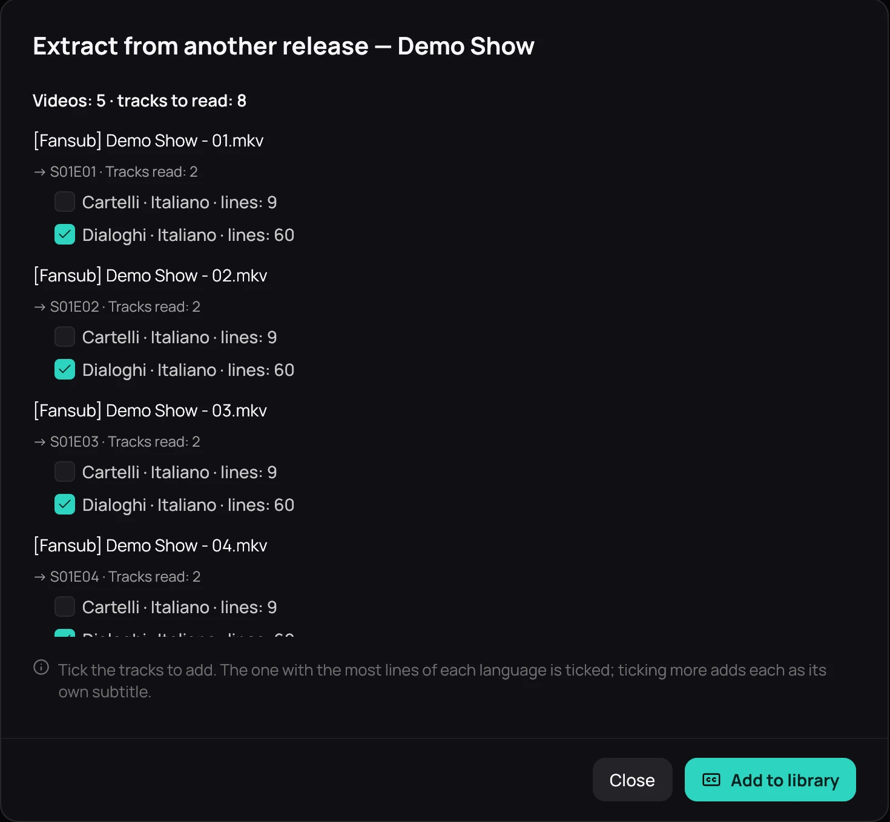

## What it is for

Another release of a series, such as a fansub, has the subtitles your own copy lacks. Kaveo reads
them out of that release's videos and puts each one onto the matching episode of your library.

## How to use it

1. Open a series', a season's or an episode's **⋯** menu and choose **Extract from another release…**.
2. Click **Add folder…** or **Add videos…** and pick the other release. Click **Extract**.
3. Under each video, tick the tracks you want and click **Add to library**.
4. Click **Resync subtitles…**, so the subtitles follow your copy's timing.
5. When the resync is done, click **Take subtitle positions…** to place signs as your release does.

## Good to know

- The episode comes from each video's name, such as *Show - 03* or *S01E03*.
- The track with the most lines of each language is ticked. Tick more to add each as its own subtitle, also saved beside your episode's video.
- **Delete source files after extraction** moves the other release's videos to the Trash once every ticked track is in the library. You confirm first. Unticked tracks go with their video, but a video with nothing ticked is kept.
