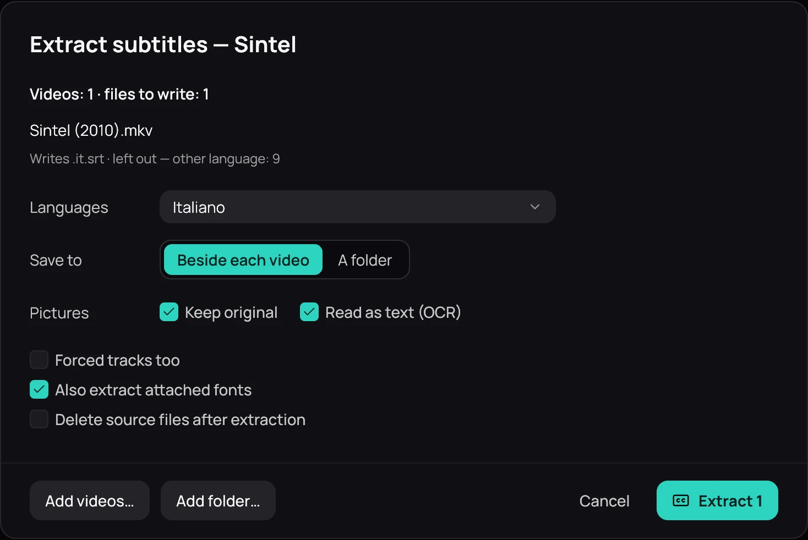

## What it is for

Take the subtitles out of a film's, an episode's, a season's, a series' or a collection's videos.
Each track becomes its own file, in its own format, named after its video: *Episode.it.ass*.

## How to use it

1. Open a title's **⋯** menu, or right-click a collection, and choose **Extract subtitles…**.
2. Each row says what is written and left out; **Add videos…** and **Add folder…** add more.
3. Under **Languages**, tick the languages you want, or choose **All languages**.
4. Click **Extract**. **Stop** ends the run.
5. Then **Show in folder** opens where the files went.

## Good to know

- The languages ticked at first are the subtitle languages set in **Settings › Subtitles**.
- An existing file is never replaced: the new one is numbered, *Episode.2.it.ass*.
- Picture subtitles (PGS, VobSub): **Keep original** writes them as they are, **Read as text (OCR)**
  as an SRT file, slowly; that needs Tesseract (**Settings › Components**).
- **Also extract attached fonts** puts a styled subtitle's fonts beside the files.
- **Onto the title** adds each subtitle to its title in Kaveo, listed in the player; nothing is
  written beside the video. A network folder's video starts there and is never deleted.
- **Delete source files after extraction** moves each video to the Trash once every subtitle chosen
  for it was written and read back. You confirm first, and a video the library holds says so. Without
  a Trash, a second question asks before deleting for good; **Keep the files** keeps them.
