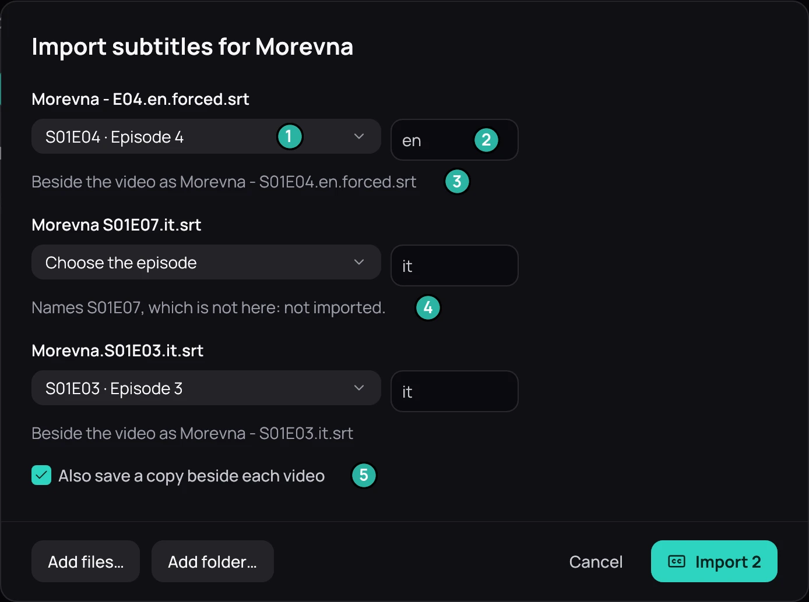

## What it is for

Bring in subtitle files you already have, for one title or a whole series at once. Kaveo matches each
file to its episode by its name and keeps a copy you can sync, edit or translate.

1. The episode the file goes to.
2. Its language.
3. The name of the copy beside the video.
4. A file that is not imported, and why.
5. **Also save a copy beside each video**.

## How to use it

1. Open a film's, an episode's or a series' **⋯** menu, or a season's, and choose **Import
   subtitles…**.
2. Click **Add files…** (a zip counts) or **Add folder…**.
3. Correct any episode or language that is wrong, or choose **Don't import**.
4. Click **Import**.

## Good to know

- A file already beside the video is never replaced: the copy gets a number, such as
  *Film.2.ita.srt*.
- **Also upload a copy to the server** appears for a Jellyfin title, and is off until you tick it.
- While a video plays, **Subtitles** › **Load subtitle file…** puts one file on screen at once; you
  can also drop files on the picture.
