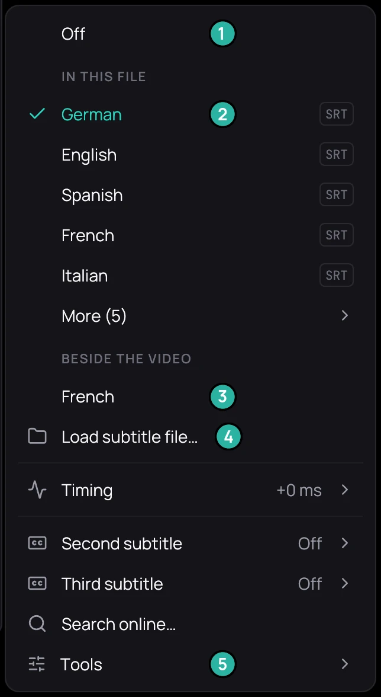

## What it is for

Play a subtitle file beside the video, a track inside it, or a file on your Jellyfin server. A file you
pick, or a track you extract, becomes your own copy to sync, edit or translate.

1. **Off**.
2. A track inside the video.
3. A subtitle file beside it.
4. **Tools**, where *Extract from this file* is.

## How to use it

1. While the video plays, right-click the picture, open **Subtitles** and pick a track under
   **In this file** (past five, under **More**) or a file under **Beside the video**.
2. To add a file, save an SRT, ASS or WebVTT file beside the video with a name starting with the
   video's own, such as *Film (2016).ita.srt*.
3. To pull a track out, open **Tools** › **Extract from this file** and click it. Kaveo reads the
   whole video, then lists the result under **Beside the video**.

## Good to know

- A picture-based track, as on most Blu-rays, cannot be extracted: its row is greyed.
- On a Jellyfin title, the server's files are under **Subtitle files on the server**: click one to play
  it (later episodes follow its language), or its bin to delete it from the server. Copied one there? See
  [New files on a server](../sources/server-scan.md).
- A private title plays only the tracks inside its video.
- If a file shows broken accents (*è* instead of *è*), **Subtitles** › **Tools** offers
  **Fix accented letters**; **Undo the accent fix** puts it back.
