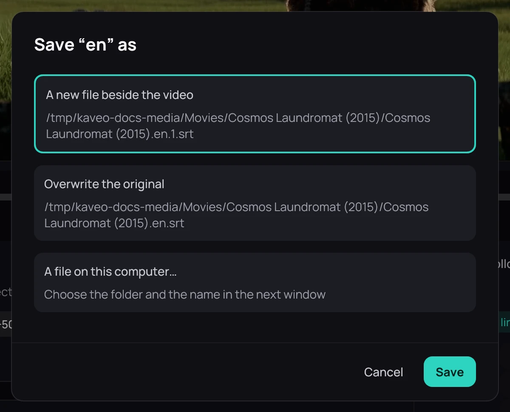

## What it is for

Kaveo keeps every change to a subtitle as you make it, but no other player sees it until you save
it somewhere.

## How to use it

1. In the subtitle editor or on the **All lines…** page, click **Save**, or press **Ctrl+S**. The
   first time, Kaveo asks where.
2. Choose **A new file beside the video**, **A new file on the server** for a Jellyfin title,
   **Overwrite the original**, or **A file on this computer…**, then click **Save**.
3. **Save as…**, or **Ctrl+Shift+S**, picks another place. Both are also in **Subtitles** › **Tools**.

## Good to know

- After the first time, **Save** writes to the same place.
- Overwriting asks first. With **Keep a backup copy** ticked, **Restore the original** in
  **Subtitles** › **Tools** puts the old file back.
- On a server, Kaveo removes the original and uploads the new file under its name. If the upload
  fails, the original goes back.
- Syncing, the delay written into the file and an accent fix save again where you saved.
- Removing a subtitle in Kaveo never deletes a file you saved.
