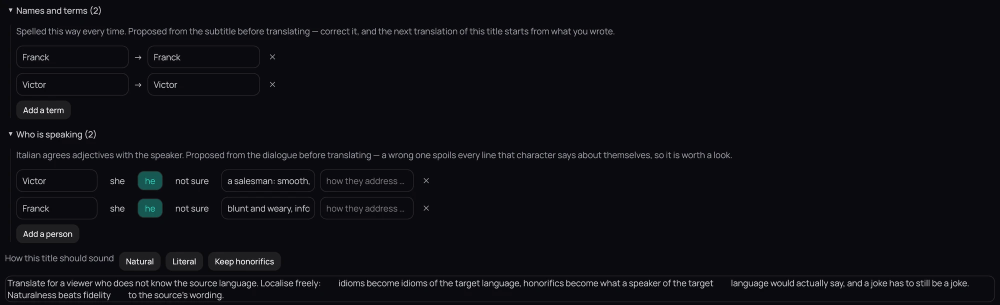

## What it is for

Tell Kaveo, before it translates, how to spell names, who is speaking and how the result should sound.

## How to use it

1. With the subtitle you translate from on screen — not an earlier translation — press **E** and click
   **All lines…**.
2. In the **Names and people** panel beside the lines, under **Names and terms**, click **Add a
   term** and write each name as it appears and how to write it.
3. Click **Who is speaking**, then **Add a person**, type the name and pick **She**, **He** or
   **Not sure**.
4. Under **How this title should sound**, click **Natural**, **Literal** or **Keep honorifics**.
5. Click **Back** to keep them, then translate.

## Good to know

- Kaveo proposes names, terms and speakers you did not describe, even when the subtitle names nobody;
  subtitles in other languages inside the video help it tell a man from a woman.
- The next episodes in the same folder reuse your names, speakers and style, add the ones each episode
  introduces without changing yours, and reuse a line you corrected wherever it returns. New lines can
  still need fixing.
- Click the number beside a term to see only the lines that say it.
- Drag the panel's edge to resize it, fold it with its arrow, or press **Move into the page**. Kaveo
  remembers the choice.
- Lines that do not fit can be fixed on the translation's **All lines…** page: **Break the row** and
  **Give time** change no word.
