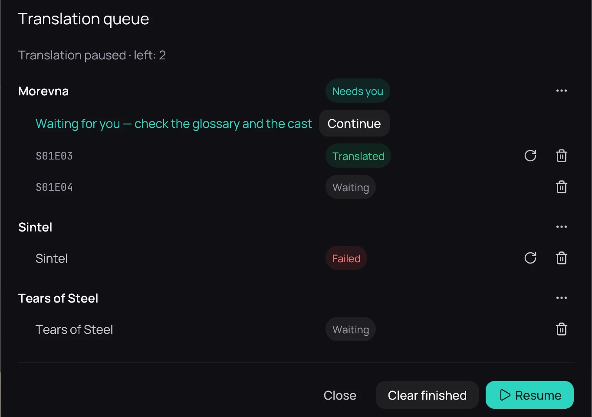

## What it is for

Watch and steer the subtitles waiting to be translated, after you have queued them — see
[Translating a whole series](translation-queue.md).

## How to use it

The top bar shows the queue's progress, for example *Translating 3/9 · 42%*. Click it to open the
queue.

- **Pause** stops after the request in progress; **Resume** goes on from there. Both sit at the top,
  beside the queue's status.
- A series' **⋯** holds **Move to the front**, **Move up**, **Move down** and **Remove this series
  from the queue**; episodes keep their order.
- The cross cancels the episode in progress; the bin removes an episode.
- The round arrow translates an episode again, or retries one that failed.

## Good to know

- The top bar shows nothing when the queue is empty, or when everything in it went well.
- The top bar is not shown in the player: go back to the library to see it.
- A running queue continues when Kaveo starts again.
- An episode marked in red needs you: hover over it to see why and what to do.
- A line under a finished episode names a style whose font is missing, or cannot draw some
  letters of your language. Press **Use another font for this style…** to pick an installed font
  that draws them all. Nothing changes until you do.
- A grey line under a finished episode counts the lines added from the audio. Press **Review them…**
  to see only those, and delete any that is not dialogue.
