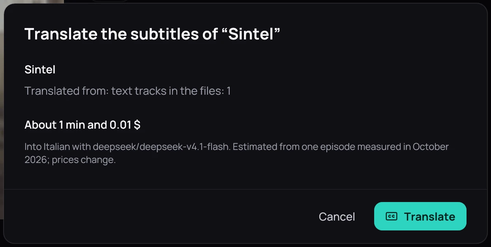
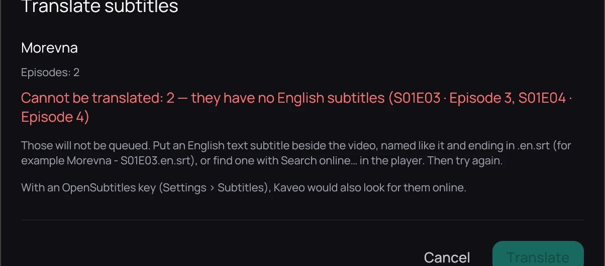

## What it is for

Translate the subtitles of a film, a season or a whole series in one go, without opening the video.
Kaveo works through them one episode at a time.

## How to use it

1. Right-click a film, an episode or a series and choose **Subtitles…**. On a film or series page
   it is in **⋯**; a season has its own **Subtitles for this season…**.
2. Check the episodes, where their text comes from, and the estimate of time and cost.
3. If some already have a translation, choose **Skip them** or **Translate them again**.
4. Press **Translate**.

## When an episode cannot be translated

Kaveo translates from English text. If an episode's English subtitles are only pictures (PGS), or
missing, the dialog says so in red and does not queue it.

Put an English text subtitle beside the video, with the same name ending in *.en.srt*, or find one
with **Search online…** in the player. On Jellyfin, add it on the server. Then try again.

## Good to know

- To follow or retry what is queued, see [Following the translation queue](translation-queue-panel.md).
- Online: [OpenSubtitles for a series](translation-queue-online.md).
- On a new series, keep **Stop after the first episode** ticked, check that episode, then press
  **Continue** in the queue: the next episodes use your corrections.
- A playing video gets the graphics card first.
- Jellyfin titles can be queued too; a title in both places shares its subtitles. Set up a
  provider: see [Translating subtitles](translate.md).
