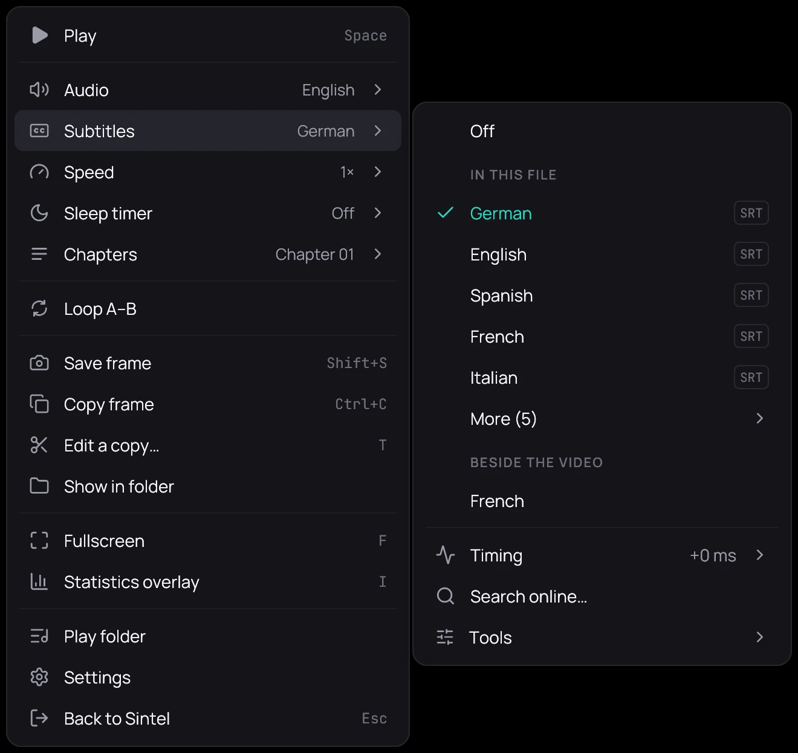

## What it is for

When a video carries more than one soundtrack or subtitle, choose which one plays.

## How to use it

1. While a video plays, right-click the picture.
2. Point at **Audio** and click a track; the ticked one is playing.
3. Point at **Subtitles** and click **Off**, a track under **In this file**, or a file under
   **Beside the video**.
4. Or press **A** to step through the audio tracks, and **S** through the video's own subtitle tracks
   and off.

## Good to know

- Kaveo remembers the language you pick, or **Off**, for that film or series, later episodes
  included — from your own folders and from Jellyfin alike. A subtitle file you pick comes back
  whenever that video plays. A commentary never opens first; see
  [Audio settings](../settings/audio.md) for your languages. A private title keeps no language.
- **Audio** › **Audio delay** moves the sound 50 or 500 ms at a time, or press **K** and **L**; it is
  remembered for that film or series. The subtitles have their own, under **Subtitles** ›
  **Timing** — see [Subtitle timing](../subtitles/delay.md).
- **Audio** › **Sound** › **Output** picks where the sound leaves: the same list as
  [Audio settings](../settings/audio.md), and the title carries on from where it was.
- To get, time, write or translate a subtitle, see [Loading subtitles](../subtitles/load.md),
  [Finding subtitles online](../subtitles/online-search.md), [Syncing subtitles](../subtitles/sync.md),
  [Writing and editing subtitles](../subtitles/edit.md) and
  [Translating subtitles](../subtitles/translate.md).
