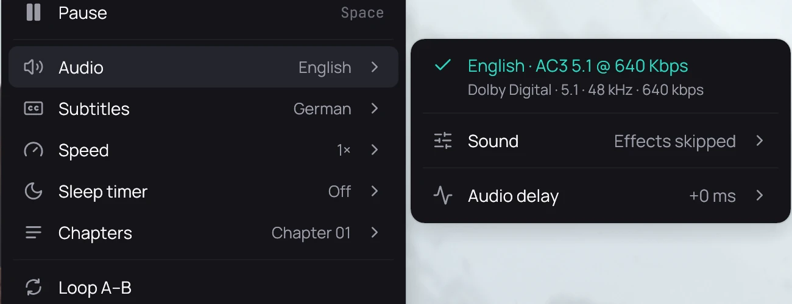

## What it is for

**D** skips your Effects while you listen, at the same loudness, so the version that is louder does
not simply sound better.

## How to use it

1. While something plays, press **D**: the effects are skipped. **D** again plays them.
2. Or right-click the picture and open **Audio** › **Sound** › **Effects**.
3. There, pick a preset or tick a stage on or off; **Edit effects…** opens the settings.

## Good to know

- The skip lasts until Kaveo closes and is never saved; the settings page says *On · skipped for now* and offers **Play it now**.
- A plugin's own level is not matched.
- The equalizer travels with the chain, so **D** skips it too.
- **Low-volume balance** is not skipped ([Low-volume balance](low-volume-balance.md)).
