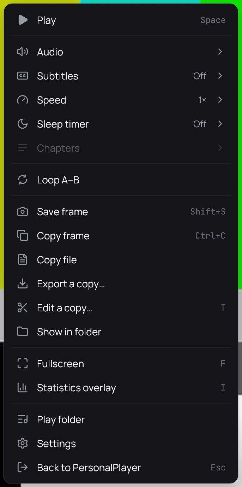

## What it is for

Copy the picture on screen, without the controls or the subtitles, or one of your own photos, into
a document or a message — or copy your own photos and videos as files.

## How to use it

### The picture on screen

1. Pause on the moment you want.
2. Right-click the picture and choose **Copy frame**, or press **Ctrl+C**.
3. When a message says the frame is copied, paste it where you want it.

### One of your own photos

1. Right-click its card, or the photo in the viewer, and choose **Copy image** — or press **Ctrl+C**
   in the viewer.
2. **Copy file** copies the file instead; a Live Photo's motion goes with it.

### One of your own videos

1. Right-click the picture while it plays, or its row on its folder's page, and choose
   **Copy file**.
2. Paste it into a folder or a message.

## Good to know

- A copied frame carries no date or place; a frame of your own video [saved](save-a-frame.md)
  keeps them. A copied video keeps everything, because it is the file itself.
- On Linux a very large picture, such as a 4K frame or a phone photo, is copied smaller, and the
  message gives both sizes.
- **Copy file** is only for the photos and videos of a
  [personal category](../library/personal-videos.md), and not for a ripped disc. Neither entry is there for a private title, a video playing from a
  server, or a trailer.
