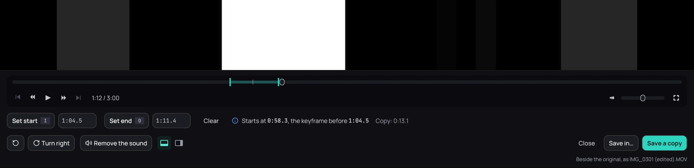

## What it is for

Keep only part of a video, turn a clip filmed sideways, or remove its sound. Kaveo saves the result
as a new file, or replaces the original if you ask. Nothing is re-encoded, so the picture and the
sound stay as they were.

## How to use it

1. Right-click the picture and choose **Edit a copy…**, or press **T**. From the library, right-click
   a video and choose **Edit a copy…**.
2. Where the copy should start, click **Set start** or press **I**; the same with **Set end** and
   **O**. You can also type a time, such as 1:15.
3. Turn it or **Remove the sound** if you want; the player shows the result.
4. Click **Save a copy**. It is saved beside the original, with *(edited)* in its name.

## Good to know

- A copy starts on the nearest keyframe before your mark, shown in the panel. **Exact start** begins
  on the very frame by re-encoding with an FFmpeg already on your computer: slower, with a tiny loss
  of quality.
- Turning works for MOV and MP4, and for any file with **Exact start**.
- **Save in…** puts the copy in another folder.
- **Replace the original…** deletes the original and puts the edited video in its place. It asks
  first and cannot be undone. MOV and MP4 files need no free space for it; others need room for a
  moment, and Kaveo says how much.
- Two buttons in the panel move it under the picture or beside it.
