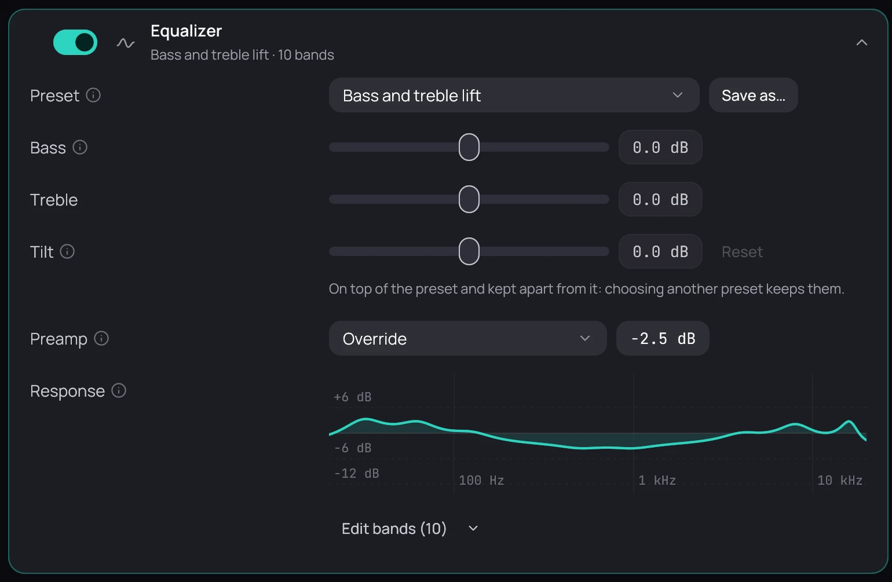

## What it is for

The equalizer raises or lowers the bass, the middle and the treble of everything you play, music and
video alike.

## How to use it

1. In **Settings › Audio**, turn on **Equalizer**; it is off to begin with.
2. Pick a **Preset**, such as **Bass boost** or **Vocal**, or move the sliders yourself.
3. Lower **Preamp** to leave room when you raise several bands; **Response** draws what they do together.
4. Type a name beside **Save as preset** and press **Save** to keep your own curve.
5. While playing, right-click the picture and open **Audio** to switch presets at once.

## Good to know

- Choosing a preset turns the equalizer on; **Off** in the **Audio** menu keeps your sliders for next time.
- It does not act on Dolby or DTS sound sent undecoded to a receiver with **Bitstream passthrough**; use the receiver's own tone controls there.
- Changes are heard straight away and fade in smoothly, without a click.
