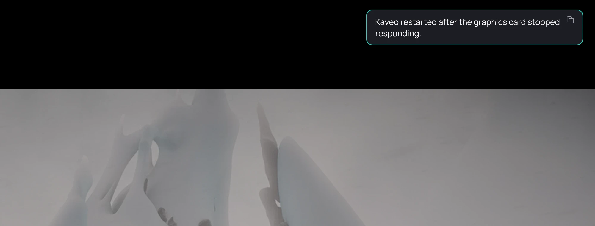

## What it is for

Now and then a graphics card stops responding for a moment — a driver timeout. Kaveo recovers from
it by itself instead of closing.

## How to use it

There is nothing to do. The window goes still for a few seconds, then:

1. The first time, the video opens again where you were, with the same settings, and *Kaveo recovered and resumed where you were* appears.
2. If it happens again within ten minutes, Kaveo returns to the library instead. Your position is
   saved: open the title to resume.
3. A third time within ten minutes, Kaveo closes with a message, *The graphics card keeps failing*.

## Good to know

- Sometimes Kaveo has to restart itself to use hardware decoding and the upscaler again. It reopens
  the video where you were and says *Kaveo restarted after the graphics card stopped responding*.

  

- After a restart, a video from a server or a private title is not reopened: open it from the library.
- If it keeps happening, try playing without the neural upscaler, update the graphics driver and
  check the displays connected to the computer.
- On an X11 desktop Kaveo always recovers by restarting: the window closes and opens again.
