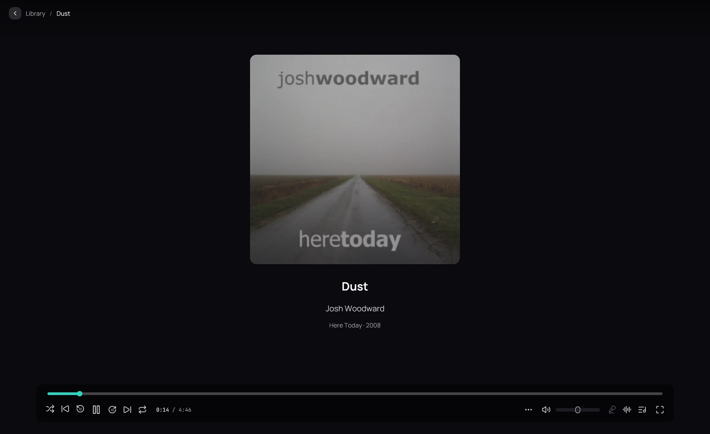

## What it is for

Play the music in your library, or any audio file on your computer, in the same player as your films.

## How to use it

1. Open an album from the **Music** category and click **Play album**, **Shuffle**, or **Play**
   beside a track.
2. The cover, the title, the artist and the album fill the window; the playback bar stays visible.
3. When a track ends, the next starts at once, with no gap: a live album plays as one piece.
4. Click the back button at the top left to keep listening while you browse: see
   [Music while you browse](music-bar.md).
5. To play a file from elsewhere, use **Open**, drop it on the window, or open it from
   [your file manager](../file-manager.md).

## Good to know

- A track always starts from the beginning: Kaveo resumes films and episodes, not music.
- MP3, FLAC, AAC, ALAC, Ogg, Opus, WavPack, WAV, AIFF, Matroska audio, M4B and DSD files play.
- Tracks of different kinds, such as a FLAC then an MP3, follow each other after a short pause.
- **Crossfade**, in **Settings › Audio**, fades one song into the next, except within an album
  unless you turn off **Not between songs of the same album**.
- A file that cannot be played is not added to *Recently played*.
- A check mark beside a track means you have played it.
- Music on a [Jellyfin server](../sources/jellyfin.md) plays the same way, streamed.
- To browse by artist, see [Artists](../library/artists.md).
