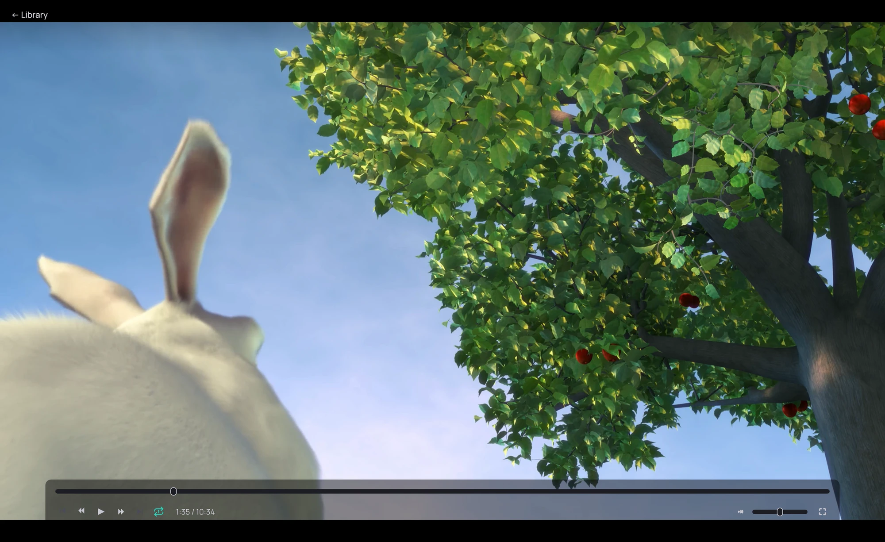

## What it is for

An advert on a screen at work, the music in a shop: Kaveo plays a video, a folder or a playlist over
and over by itself.

## How to use it

1. To repeat what is playing, click **Repeat** on the playback bar. On a single video it has two
   states, off and this video; on a list, the whole list comes first, then this item.
2. To start a loop from outside Kaveo, right-click a folder and choose **Loop this folder with
   Kaveo** ([From your file manager](../file-manager.md)), or start Kaveo with the loop option on a
   video, a folder or a playlist ([Command line](../command-line.md)).

## Good to know

- A video starts again at once, in the same window and in full screen if it was, with no *Up next*
  card between the laps; the screen does not go to sleep. Music goes from the last track to the first
  with no gap, or with the crossfade if it is on.
- A lap is not a new play: *Recently played* shows the loop once, and no position is kept.
- A file that does not play is skipped. If nothing in the list plays, the loop stops and says so.
- Started the same way after a restart, it goes on where it was; with the full screen option, it
  fills the screen at once.
- A loop leaves your own **Repeat** choices as they were. A lit **Repeat** means what plays starts
  again at its end.
