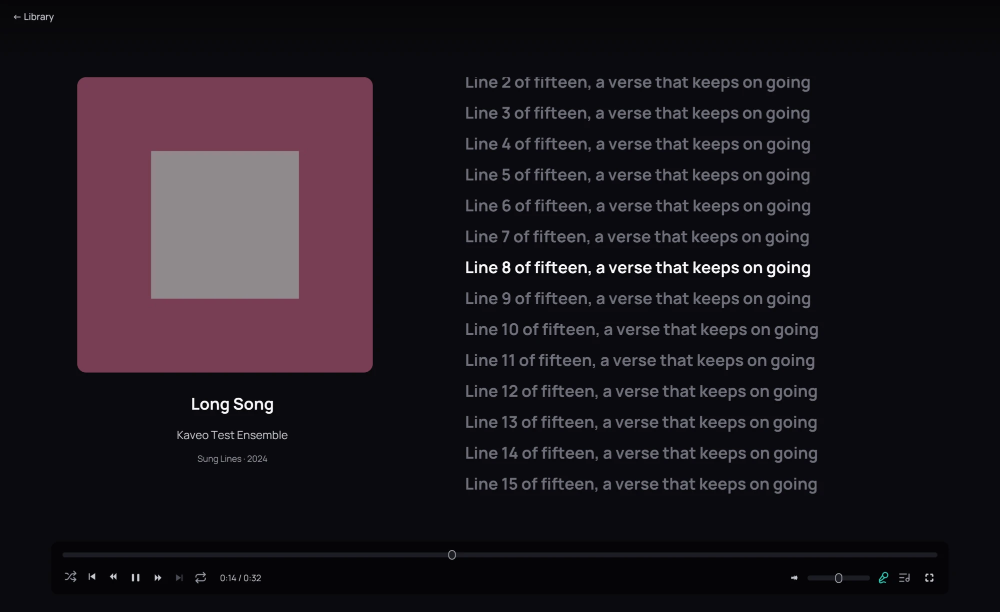

## What it is for

Follow the words of a song as it plays, and jump to any line.

## How to use it

1. Play a track that has lyrics. They appear beside the cover by themselves.
2. When the lyrics are timed, the line being sung is lit and the column scrolls to keep it in view.
3. Click a line to play the song from there.
4. Scroll with the mouse wheel to read ahead; after a few seconds the column follows the song again.
5. To hide the lyrics, click the microphone button on the playback bar. Click it again to bring them
   back; Kaveo remembers your choice until you close it.

## Good to know

- Kaveo reads a lyrics file with the same name as the track, beside it: an LRC file, an enhanced
  LRC file, or a plain text file. It also reads the lyrics stored inside the track itself.
- When a track has both timed and plain lyrics, the timed ones are shown.
- A track without lyrics has no microphone button.
- Music on a [Jellyfin server](../sources/jellyfin.md) shows the lyrics the server found for it.
  The server ignores an offset line, so lyrics that rely on one run late there.
- If the lyrics run early or late, the timing is in the lyrics file: an offset line in it moves them all.
- A track without lyrics gets LRCLIB's, unless **Lyrics online** is turned off in **Settings › Metadata**.
