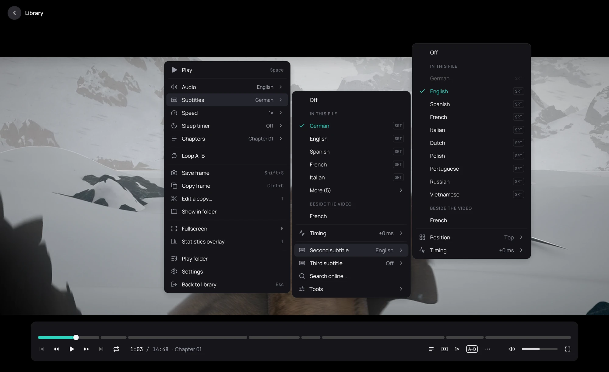

## What it is for

Show up to three subtitles at the same time: the dialogue and a separate track for signs and songs,
or the original language above a translation.

## How to use it

1. While a video plays, right-click the picture and point at **Subtitles**.
2. Point at **Second subtitle** and click a track under **In this file**, or a file under
   **Beside the video**. **Third subtitle** works the same way.
3. In the same menu, **Position** puts it **As in the file** or at the **Top**.
4. **Timing** moves only that subtitle, 50 or 500 ms at a time.

## Good to know

- Kaveo remembers your second and third subtitle for that film or series, and finds the same track
  again in the next episode by its language and name. If an episode has no such track, it says so.
- **Z** and **X** move only the first subtitle.
- A subtitle already on screen cannot be picked twice; point at its greyed row to see why.
