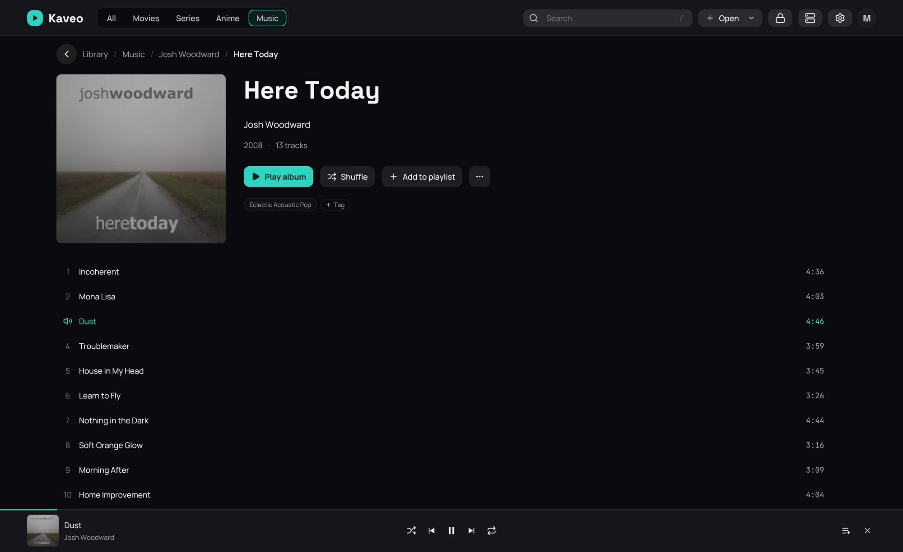

## What it is for

Browse your library, or anything else in Kaveo, while a track plays, with its controls at the bottom
of the window.

## How to use it

1. While a track plays, click the back button at the top left of the player: the page you came from
   returns, and the music goes on.
2. Use the bar's buttons to pause, skip, shuffle the queue or repeat it.
3. Click the cover or the title to return to the player.
4. Click the cross to stop.

## Good to know

- Repeat has three states: off, the whole list, and this track. The track's own end repeats it;
  Next still moves on.
- Music keeps its own shuffle and repeat, apart from videos', and Kaveo remembers them after a
  restart. With shuffle on, an album or playlist you play starts shuffled.
- After a restart, the bar shows *Queue from your last session*: the play button starts it again.
- The queue's **Save as playlist…** keeps it under a name: see [Playlists](../library/playlists.md).
