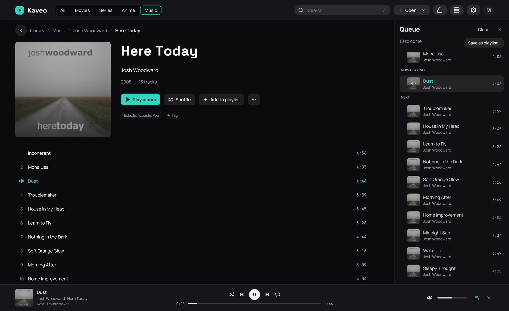

## What it is for

Line up tracks from several albums, and see, reorder or trim what is still to come.

## How to use it

1. On an album page, click the three dots beside a track, or right-click the track.
2. Choose **Play next** to hear it after the current track, or **Add to queue** to put it at the end.
3. Open the queue with the list button on the playback bar or on the bar at the bottom of the window.
4. Click a track to play it; use the arrows to move it, the cross to take it out, and **Clear** to
   empty what is still to come.

## Good to know

- Queuing a track while an album plays keeps the rest of the album: the queue starts from it.
- A track already in the queue is not added twice; **Play next** moves it instead.
- If you close Kaveo while music plays, the queue is still there next time.
