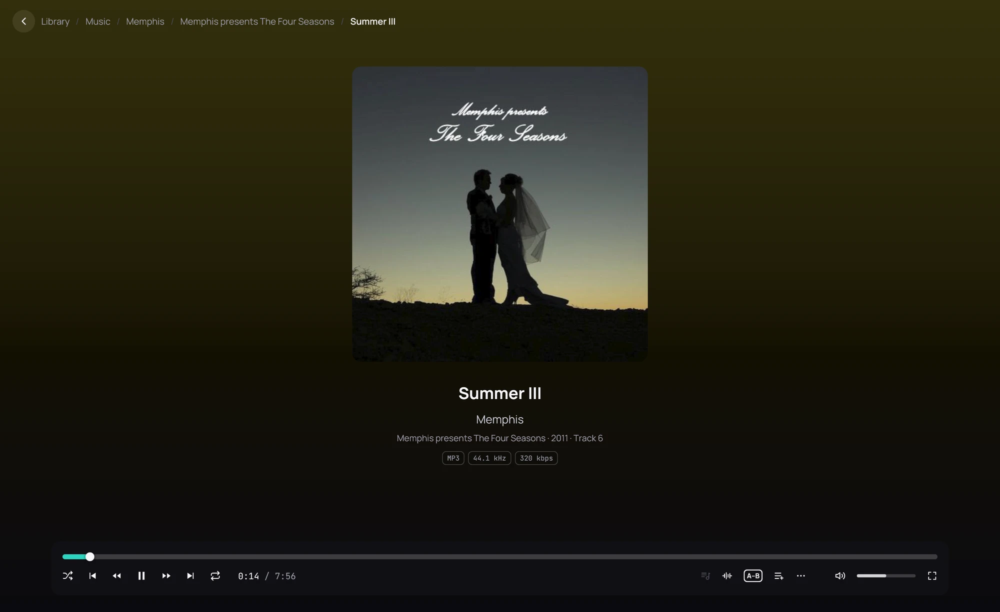

## What it is for

See what is playing and where it comes from, go on to its artist or its album, and arrange the screen
the way you like it.

## How to use it

1. Play a song: its cover fills the middle, over a background in the cover's colour.
2. Click the artist or the album under the title to open its page; the song goes on playing in the
   bar at the bottom.
3. The album line gives the year and the track's number, and how many the album has when the file
   says so.
4. The boxes under it name the file's format: its kind, its bit depth for a lossless file, its sample
   rate, and its bitrate for a compressed one.
5. Open **⋯** › **Layout** on the playback bar to arrange the screen: **Classic** (the cover in the
   middle), **Side by side** (the cover on the left, the words beside it) or **Lyrics**
   (a small cover, the lyrics filling the screen). **Format chips** hides the boxes; **Open lyrics by
   themselves** off starts each song with its lyrics hidden.

## Good to know

- Turn off **Colour from the cover** in [Settings › Interface](../settings/interface.md) for a plain
  background; the **Light** and **High contrast** player themes always keep one.
- Your layout is kept. **Lyrics** needs a song with [lyrics](lyrics.md); without them the screen is
  **Classic**, and **Side by side** is too in a narrow window.
- The queue (the list button on the bar) says what plays next.
