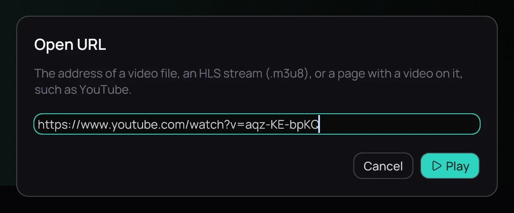

## What it is for

Play something that is not on your disk: a video file or a stream on the web, or a page with a video
on it, such as YouTube's.

## How to use it

1. Click **Open URL…** in the top bar, or press **Ctrl+L**. An address you copied is already in the field.
2. Click **Play**. A page takes a few seconds to read; **Cancel** stops it.
3. To change how sharp it plays, right-click the picture and choose **Quality**; it goes on from where it was.
4. The address joins **Recently played**, and opens from there where you left it.

## Good to know

- A live stream has no seek bar and shows **LIVE**; it is never resumed.
- When an address cannot be played, Kaveo says why and what to do — for a site that wants you signed
  in, choose your browser under **Site cookies** in [Metadata](../settings/metadata.md).
- The sharpness it starts at is set under [Behaviour](../settings/behaviour.md). From a terminal, see
  [Command line](../command-line.md).
